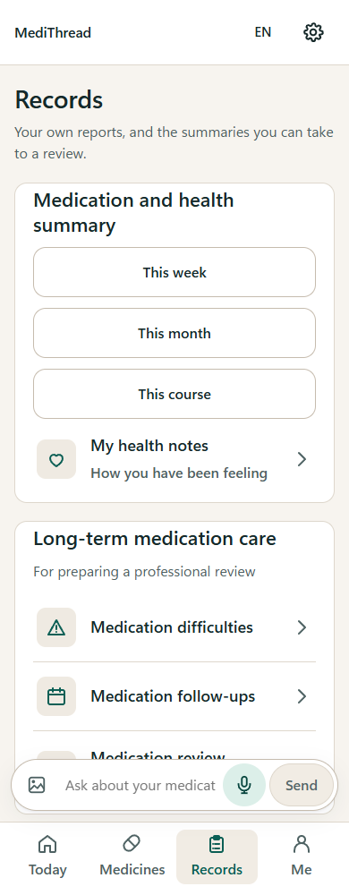
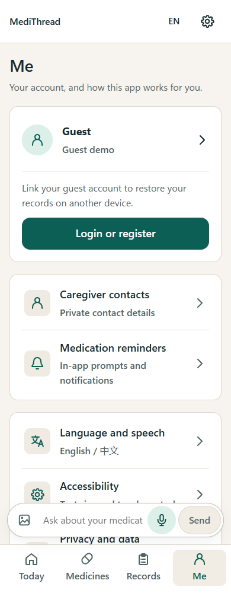
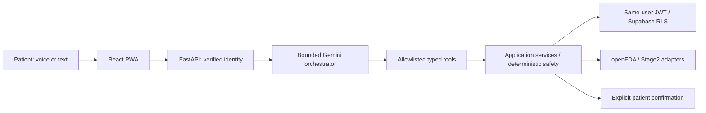

# MediThread

## Your medication and self-care companion

**Understand your medicines. Follow reviewed plans. Prepare for your next care review.**


- **Team Name:** PharmaScan
- **Developers:** DING ZIXIN · Pan Shengxin
- **Technical Subtitle:** A Personalised Medication & Long-Term Self-Care Agent
- **Designed for:** adult patients, with larger text and voice-first interaction
- **Languages:** English / 中文

---

## Contents

[Overview](#1-project-overview) · [Capabilities](#2-challenge-2-capabilities) · [Pages &amp; Features](#3-app-pages--features) · [Architecture](#4-agentic-workflow--architecture) · [Tech Stack](#5-tech-stack) · [Development](#6-development--deployment) · [Project Structure](#7-project-structure) · [Patient Control](#8-patient-control) · [Future Directions](#9-future-directions) · [License](#10-license--brand-history)

---

## 1. Project Overview

- **Understand medicines:** review source evidence and clarify missing information.
- **Manage daily care:** follow confirmed plans; report **taken / not taken / unsure**.
- **Track long-term needs:** record supply, refills, symptoms, measurements and follow-ups.
- **Prepare for appointments:** review your records and export questions for a pharmacist or doctor.
- **Speak or type:** open the Assistant over the current page; review actions before confirming.
- **Control conversation privacy:** choose whether to save new chats. Clinical facts remain separate from chat history.

---

## 2. Challenge 2 Capabilities

| Capability                                        | What MediThread helps patients do                                                                                                                                                                          |
| ------------------------------------------------- | ---------------------------------------------------------------------------------------------------------------------------------------------------------------------------------------------------------- |
| **Medication Understanding**                | **General uses:** matched drug-label excerpts with sources.**Personal instructions:** the patient's confirmed plan.Unclear products or instructions prompt clarification.                      |
| **Medication Management**                   | **Current and past plans**, medication identity and source evidence.Review changes and confirm actions before saving.                                                                                |
| **Adherence Support**                       | Report **taken / not taken / unsure**.Record barriers such as forgetting, unclear directions or low supply.Arrange confirmed follow-ups; missing reports stay **unrecorded**, not missed.      |
| **Health Tracking**                         | Record medication-related **measurements and symptoms**.Review descriptive trends with dates, units and sample counts.No diagnosis or medication-causality claim.                                    |
| **Preventive Health — medication-related** | Track **refills, medication reviews and treatment-related monitoring**.Follow up on reported symptoms or adherence difficulties.General screening and vaccination recommendations are outside scope. |
| **Healthcare Preparation**                  | Review **medication history, dose reports, observations, barriers and supply concerns**.Add questions and export a summary.Nothing is automatically sent to a clinician.                             |

---

## 3. App Pages & Features

Four pages bring daily medication care, long-term records and personal preferences together.

| Today                                                                                  | Medicines                                                                                          | Records                                                                                                      | Me                                                                                          |
| -------------------------------------------------------------------------------------- | -------------------------------------------------------------------------------------------------- | ------------------------------------------------------------------------------------------------------------ | ------------------------------------------------------------------------------------------- |
| **Follow your day**                                                              | **Organise your medicines**                                                                  | **Understand your progress**                                                                           | **Make it yours**                                                                     |
|  |        |           |  |
| Daily medication plansDose reportsIntegrated AI AssistantUpcoming follow-ups           | Current and past plansIdentity and source evidencePrivate photo referencesStock and refill history | Dose history and difficultiesHealth notes and trendsMedication-related follow-upsReview summaries and export | Profile and accountCaregiver contactsReminder preferencesLanguage, voice and accessibility  |

*Screenshots use synthetic demonstration data.*

---

## 4. Agentic Workflow & Architecture



- **Gemini:** interprets intent and chooses allowlisted tools.
- **Application services:** enforce patient isolation, source review and retry-safe writes.
- **Sensitive actions:** require independent patient confirmation.
- **Medication knowledge:** general US labels never replace personal reviewed instructions.
- **Visual evidence:** similarity does not prove contents, safe dosage or ingestion.

---

## 5. Tech Stack

| Layer                            | Technology / responsibility                                                                         |
| -------------------------------- | --------------------------------------------------------------------------------------------------- |
| **Patient app**            | React 18 · TypeScript · Vite                                                                      |
| **Backend**                | FastAPI · Pydantic v2 · typed application services                                                |
| **Identity & persistence** | Supabase Auth · PostgreSQL / RLS · private Storage                                                |
| **Agent**                  | Gemini bounded orchestration; identified deterministic fallback                                     |
| **Visual provider**        | External Stage2 **API v0.10.0**; encoder / embedding versions tracked separately              |
| **Medication knowledge**   | Conservatively matched openFDA label excerpts with citations                                        |
| **Voice**                  | Browser recognition / synthesis by default; optional Tencent speech requires explicit configuration |

---

## 6. Development & Deployment

- [Local setup, configuration, running and testing](docs/DEVELOPMENT.md)
- [Project structure and component directory map](docs/PROJECT_STRUCTURE.md)
- [Architecture](docs/ARCHITECTURE.md) / [API contracts](docs/API_CONTRACTS.md) / [data model](docs/DATA_MODEL.md)
- [Challenge 2 workflows, evidence and verification limits](docs/CHALLENGE2.md)
- [Deployment checklist](docs/DEPLOYMENT_CHECKLIST.md) / [Render patient API](docs/RENDER_DEPLOYMENT.md) / [service entrypoints](deploy/README.md)
- [Reminders and Web Push](docs/REMINDERS.md) / [safety and evaluation](docs/SAFETY_AND_EVALUATION.md)

**Selected MVP deployment:**

- **Frontend:** Vercel.
- **Patient API:** Render Free.
- **Identity, database and private files:** existing Supabase project.
- **Optional Web Push:** isolated Vercel Python Dispatcher.

**Before public use:** configure hosting, HTTPS routing and Auth redirects; complete hosted smoke tests. Keep Dispatcher credentials separate from the patient API and frontend.

---

## 7. Project Structure

> Organised by patient application, backend services, persistence, deployment and documentation.

```text
pharmascan-care-agent/
├── frontend/       # MediThread React / TypeScript patient app
├── backend/        # FastAPI, application services and typed Agent tools
├── supabase/       # Versioned SQL migrations and rollback guards
├── deploy/         # Separate frontend, patient API and Dispatcher deployment files
├── scripts/        # Local startup, migrations and bounded notification worker
├── tests/          # Backend regressions and synthetic Stage2 contract fixtures
├── docs/           # Public architecture, setup, safety and product documentation
├── README.md       # Product overview and current status
└── pyproject.toml  # Python package, dependencies and tooling configuration
```

See the [detailed Project Structure](docs/PROJECT_STRUCTURE.md) for
annotated directory trees and component responsibilities. The repository retains
its original engineering name; the product is MediThread.

---

## 8. Patient Control

- **Reviewed instructions:** personal plans stay connected to their source evidence.
- **Explicit confirmation:** patients review sensitive changes before they are saved.
- **Clear records:** reported outcomes and uncertainty remain distinguishable.
- **Privacy choices:** patients choose whether to save conversations and when to export or share a summary.

See [product behaviour and data notes](docs/DEVELOPMENT.md#product-behaviour--data-notes)
for detailed operating conditions, and [safety and evaluation](docs/SAFETY_AND_EVALUATION.md)
for evidence requirements.

---

## 9. Future Directions

Planned improvements focus on making everyday medication care easier and more personal.

| Direction                                | Patient benefit                                                                                                   |
| ---------------------------------------- | ----------------------------------------------------------------------------------------------------------------- |
| **More languages**                 | Read instructions, ask questions and use voice features in a preferred language.                                  |
| **Caregiver collaboration**        | Choose which medication-related updates to share with an authorised caregiver, with clear, revocable permissions. |
| **More convenient reminders**      | Receive more dependable phone reminders and complete daily check-ins with fewer steps.                            |
| **More personalised follow-up**    | Tailor check-ins to preferred routines, reported difficulties and unresolved medication-care needs.               |
| **Broader medication education**   | Understand more medicines through clear explanations and traceable sources relevant to local products.            |
| **Better appointment preparation** | Choose what to include in a visit summary and organise questions around changes since the previous review.        |

---

## 10. License & Brand History

- **Project source:** [Apache-2.0](LICENSE). See [NOTICE](NOTICE).
- **External services and data:** retain their own terms; see [third-party notices](docs/legal/THIRD_PARTY_NOTICES.md).
- **DDInter:** Stage2-declared resources include noncommercial/share-alike restrictions. The project licence grants no third-party data rights or commercial clinical suitability.

MediThread was developed under the working title PharmaScan Care. Earlier development records and repository names retain this title.
