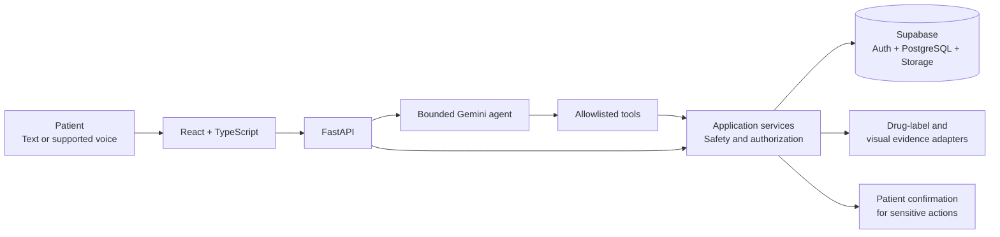

<p align="right"><strong>English</strong> · <a href="README.zh-CN.md">简体中文</a></p>

<h1 align="center">MediThread</h1>

<h2 align="center">Medication care, from today's dose to your next review.</h2>

<p align="center">
  A voice-first companion connecting reviewed medication plans, daily care records and appointment preparation.
</p>

<p align="center">
  <a href="https://medithread.vercel.app"><strong>Open MediThread ↗</strong></a>
  &nbsp;·&nbsp;
  <a href="#what-you-can-do">Explore features</a>
  &nbsp;·&nbsp;
  <a href="#run-locally">Run locally</a>
</p>

<p align="center"><strong>Understand medicines</strong> · <strong>Track daily care</strong> · <strong>Prepare for reviews</strong></p>

---

## Why MediThread?

Managing medication involves more than remembering a dose. Instructions change, questions arise, and the details of everyday care can be difficult to reconstruct at a medical appointment.

MediThread brings medication information, patient-reported records and follow-up questions into one place. Its assistant helps patients navigate those records and use source-linked medication information, while the application keeps personal instructions and recorded events distinct.

## What you can do

| | Capability | In MediThread |
|:--:|---|---|
| 01 | **Understand medicines** | Ask about general medication uses and review available drug-label information with its source. |
| 02 | **Manage medication plans** | Enrol medicines, review source documents and confirmed instructions, and view current or previous regimens. |
| 03 | **Keep a dose record** | Report **taken**, **not taken** or **unsure**; revisit the history and record barriers to taking medication. |
| 04 | **Track health and follow-ups** | Capture measurements, symptoms, supply concerns, refills and medication-related follow-up tasks. |
| 05 | **Talk with the assistant** | Ask by text or supported voice input, use medication context and return to saved conversations. |
| 06 | **Prepare for a care review** | Bring together medication changes, dose reports, observations and questions in an exportable summary. |

**A record is not an assumption.** An unreported scheduled dose is *unrecorded*, not automatically *missed*. General drug information is presented separately from a patient's reviewed instructions.

## The app

Four care pages and a dedicated assistant workspace support the daily workflow.

| Area | Purpose |
|---|---|
| **Today** | See today's schedule, report doses and check follow-ups without leaving the daily view. |
| **Medicines** | Review medication identity, product details, source evidence, regimens and supply information. |
| **Records** | Browse dose events, health observations, medication difficulties and review summaries. |
| **Me** | Manage account details, preferences, accessibility and conversation-history settings. |
| **Assistant** | Ask questions across medication and self-care topics, with separate saved conversation threads. |

### Conversations that can continue

The current development branch supports creating separate conversations, reopening a saved thread and continuing it with bounded historical context. Today and the full Assistant workspace share conversation state. Older messages without a reliable thread association remain available for read-only review.

Medication facts that can change, such as the active regimen, are retrieved again rather than treated as permanent truths from an older conversation.

## How it works



The agent interprets questions and selects tools. Application services enforce patient ownership, medication-plan rules and confirmation before sensitive changes. Medication identity, product strength, regimen versions, planned occurrences and patient-reported events remain separate in the data model.

See the [architecture](docs/ARCHITECTURE.md), [API contracts](docs/API_CONTRACTS.md), [data model](docs/DATA_MODEL.md) and [safety evaluation](docs/SAFETY_AND_EVALUATION.md).

## Technology

| Layer | Technologies |
|---|---|
| **Patient app** | React 18, TypeScript, Vite |
| **Backend** | Python, FastAPI, Pydantic v2 |
| **Identity & data** | Supabase Auth, PostgreSQL with RLS, private Storage |
| **AI assistant** | Gemini tool calling, bounded context, deterministic safety checks |
| **Medication information** | Source-linked openFDA drug labels |
| **Visual workflows** | Document/OCR flows, personal photo references, external Stage2 adapter |
| **Speech** | Browser speech recognition and synthesis; optional Tencent integration |
| **Hosting** | Vercel web app, Render API, separate Web Push dispatcher |

## Development status

**18 October 2026 · Development branch**

- **Conversation continuity:** implemented and verified in local API, PostgreSQL and browser tests. Supabase migration `026` has been applied.
- **Temporal correctness:** local changes now preserve patient-local dates and historical regimen association. The original patient-answer audit stands at **25/30 passing**; the remaining five cases concern answer completeness.
- **Pending release work:** audit-contract migration `028` is tested locally but not applied to production. Updated backend/frontend code has not been deployed. Medication knowledge, multi-turn clarification, record presentation and hosted integration checks remain under development.

The [hosted app](https://medithread.vercel.app) may therefore show an earlier build. For the validation scope, see [Challenge 2 workflows](docs/CHALLENGE2.md) and the [deployment checklist](docs/DEPLOYMENT_CHECKLIST.md).

## Run locally

**Prerequisites:** Python 3.11+, Node.js 22.12+, and npm. From the repository root in Windows PowerShell:

```powershell
python -m venv .venv
.venv\Scripts\Activate.ps1
python -m pip install -e ".[dev,push]"
Copy-Item .env.example .env
Copy-Item frontend/.env.example frontend/.env.local
npm --prefix frontend ci
python scripts/start_dev.py
```

Set environment variables for your intended local mode before starting services. See [development instructions](docs/DEVELOPMENT.md) for configuration and tests.

**Further documentation:** [Project structure](docs/PROJECT_STRUCTURE.md) · [Conversation threads](docs/CONVERSATIONS.md) · [Reminders](docs/REMINDERS.md) · [Render deployment](docs/RENDER_DEPLOYMENT.md) · [Service entrypoints](deploy/README.md)

## Repository structure

```text
pharmascan-care-agent/
├── frontend/         React app and browser tests
├── backend/          FastAPI, agent and application services
├── supabase/         Versioned database migrations
├── deploy/           Service and hosting configuration
├── scripts/          Development and operational commands
├── tests/            Backend and integration tests
├── docs/             Product and engineering documentation
├── README.md         English
├── README.zh-CN.md   简体中文
└── pyproject.toml
```

## Project & license

**Team:** PharmaScan  
**Developers:** DING ZIXIN · Pan Shengxin  
**Track:** Tencent Cloud AI CAN DO IT Hackathon Singapore 2026 · Healthcare Challenge 2  
**Audience:** Adults managing ongoing medication · **Interface:** English / 中文

MediThread was previously developed under the working title *PharmaScan Care*, which remains in the repository name and older engineering records.

Project source: [Apache-2.0](LICENSE) · [NOTICE](NOTICE) · [Third-party licenses and data terms](docs/legal/THIRD_PARTY_NOTICES.md)
