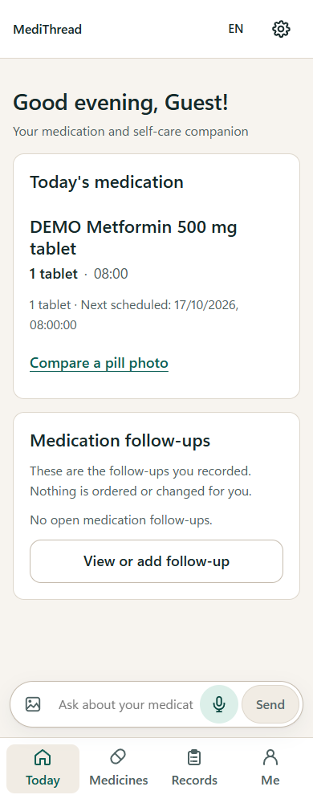
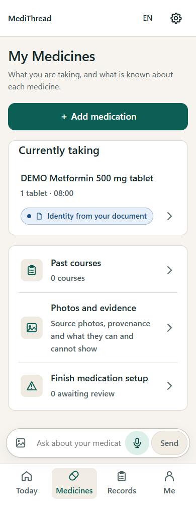
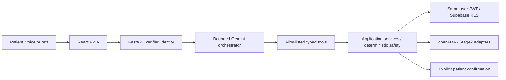

# MediThread

**Your medication and self-care companion**

*A Personalised Medication & Long-Term Self-Care Agent*

MediThread helps adult patients keep track of their medicines, understand reviewed instructions, record daily experiences and prepare for a pharmacist or doctor visit. Its voice-first, AI-assisted experience supports English and Chinese, adjustable text size and four simple destinations: **Today / Medicines / Records / Me**.

**Project status:** release candidate with local integration checks passed; hosted acceptance is pending. No public demo URL is published yet. Web Push is implemented locally; hosted scheduling and real-device delivery remain unverified. This is a synthetic-data research/demo prototype, not a clinically validated medical device.

## Contents

[Overview](#1-project-overview) · [Capabilities](#2-challenge-2-capabilities) · [Screenshots](#3-product-screenshots) · [Architecture](#4-agentic-workflow--architecture) · [Tech Stack](#5-tech-stack) · [Development](#6-development--deployment) · [Project Structure](#7-project-structure) · [Limitations](#8-scope--limitations) · [License](#9-license--brand-history)

---

## 1. Project Overview

- **Understand and organise medicines.** Review label/package evidence, resolve missing information, then explicitly confirm a treatment plan. Keep current and historical plans separate.
- **Follow the day with confidence.** See applicable schedules, record taken/not taken/unsure, and tell the assistant about practical difficulties. A missing report is never treated as a confirmed missed dose.
- **Keep care connected over time.** Confirm stock counts and refills, record relevant measurements or symptoms, follow up on medication-related tasks and prepare an editable review summary.
- **Ask naturally.** Open the assistant over the current page; speak or type, review proposed actions and choose whether to save new conversations. Long-term facts come from authorised patient records rather than raw chat.

---

## 2. Challenge 2 Capabilities

| Capability | What MediThread helps patients do |
|---|---|
| Medication Understanding | Learn a medicine’s general uses from a matched, sourced drug-label excerpt, and separately review personal instructions from their confirmed medication plan. If the product or its instructions are unclear, the app asks for clarification instead of guessing. |
| Medication Management | Keep medication identity, source evidence and reviewed treatment plans organized over time; review changes, see current and past plans, and report dose status through the app’s confirmation flow. |
| Adherence Support | Record whether a planned dose was reported taken, not taken or unsure, and tell the app about barriers such as forgetting, unclear directions or low supply. The app can help arrange a patient-confirmed follow-up; an unreported dose is not treated as missed. |
| Health Tracking | Record medication-related measurements and symptoms, then review descriptive trends with their date range, units and number of observations. Trends do not diagnose a condition or prove that a medicine caused a change. |
| Preventive Health (medication-related) | Keep track of medication reviews, refill needs, adherence or symptom follow-ups, and treatment-related monitoring tasks. The app does not provide general screening or vaccination recommendations. |
| Healthcare Preparation | Prepare a review summary from the patient’s current and past medication plans, reported dose history, observations, barriers, supply concerns and open follow-ups, so the patient can check what to discuss with a doctor or pharmacist. The app does not send the summary automatically. |

---

## 3. Product Screenshots

Screenshots below show the actual React app running against an isolated local Application API with explicitly synthetic medication data. They do not establish hosted deployment or clinical validation.

| Today | Medicines |
| --- | --- |
|  |  |

---

## 4. Agentic Workflow & Architecture



Gemini interprets intent and chooses tools. Services enforce patient isolation, source review, validation and retry-safe writes; sensitive actions require independent confirmation. General US drug-label information cannot replace personal reviewed instructions. Visual similarity never proves medication contents, safe dosage or ingestion.

---

## 5. Tech Stack

React 18, TypeScript, Vite, FastAPI, Pydantic v2 and Supabase Auth/PostgreSQL/private Storage. Gemini provides bounded orchestration with a clearly identified deterministic fallback. Stage2 is an external visual provider with frozen **API v0.10.0**; its API version is separate from encoder/embedding versions. General medication knowledge uses conservatively matched openFDA label excerpts with citations. Browser speech recognition and synthesis are the current defaults; optional Tencent speech is explicitly configured and server-gated.

---

## 6. Development & Deployment

- [Local setup, configuration, running and testing](docs/DEVELOPMENT.md)
- [Project structure and component directory map](docs/PROJECT_STRUCTURE.md)
- [Architecture](docs/ARCHITECTURE.md) / [API contracts](docs/API_CONTRACTS.md) / [data model](docs/DATA_MODEL.md)
- [Challenge 2 workflows, evidence and verification limits](docs/CHALLENGE2.md)
- [Deployment checklist](docs/DEPLOYMENT_CHECKLIST.md) / [Render patient API](docs/RENDER_DEPLOYMENT.md) / [service entrypoints](deploy/README.md)
- [Reminders and Web Push](docs/REMINDERS.md) / [safety and evaluation](docs/SAFETY_AND_EVALUATION.md)

The selected MVP topology is **Vercel frontend + Render Free patient API + existing Supabase**. An optional, isolated Vercel Python Dispatcher handles scheduled Web Push. Never share its privileged credentials with the frontend or patient API. Hosting, HTTPS routing, Auth redirects and production smoke tests require owner configuration; a successful local build is not a deployed service.

---

## 7. Project Structure

> Organised by patient application, backend services, persistence, deployment and documentation.

<details>
<summary>Repository overview</summary>

```text
pharmascan-care-agent/
├── frontend/       # MediThread React / TypeScript patient app
├── backend/        # FastAPI, application services and typed Agent tools
├── supabase/       # Versioned SQL migrations and rollback guards
├── deploy/         # Separate frontend, patient API and Dispatcher deployment files
├── scripts/        # Local startup, migrations and bounded notification worker
├── tests/          # Backend regressions and synthetic Stage2 contract fixtures
├── docs/           # Public architecture, setup, safety and product documentation
├── README.md       # Product overview and current status
└── pyproject.toml  # Python package, dependencies and tooling configuration
```

</details>

See the [detailed Project Structure](docs/PROJECT_STRUCTURE.md) for expandable,
annotated directory trees and component responsibilities. The repository retains
its original engineering name; the product is MediThread.

---

## 8. Scope & Limitations

- Personal dosing comes from reviewed patient instructions. The app never derives a prescribed pill count from strength alone; unsupported conversions abstain.
- Overlapping plans for the same normalised medicine name or known product ID are conservatively blocked, including different doses and PRN/scheduled combinations. This is an MVP limitation, not a judgment that a prescription is medically wrong.
- Inventory is a patient-confirmed count plus transparent report-based estimates; trends describe recorded samples and do not establish medication causality.
- Enrollment accepts supported images or reviewed manual entry. PDF ingestion and transparent-blister identification are not verified patient workflows.
- Calendar export is a manual, one-time import. Caregiver contact/consent management does not establish verified notification delivery. Web Push is not a native system alarm.
- Saved conversation viewing is opt-in: up to 200 exchanges from the last 30 days. Older/excess archive rows are purged on a later append, not by a timed deletion job; explicit Clear is separate from clinical records.
- General screening, vaccines, prescribing and automatic pharmacy ordering are outside this release. Native apps and broader authorised caregiver delivery remain future work.

---

## 9. License & Brand History

Source code is licensed under [Apache-2.0](LICENSE). See [NOTICE](NOTICE) and [third-party notices](docs/legal/THIRD_PARTY_NOTICES.md). External models, services, content and datasets retain their own terms. Stage2-declared DDInter resources include noncommercial/share-alike restrictions; the project license does not grant rights to third-party data or establish commercial clinical suitability.

MediThread was developed under the working title PharmaScan Care. Earlier development records and repository names retain this title.
