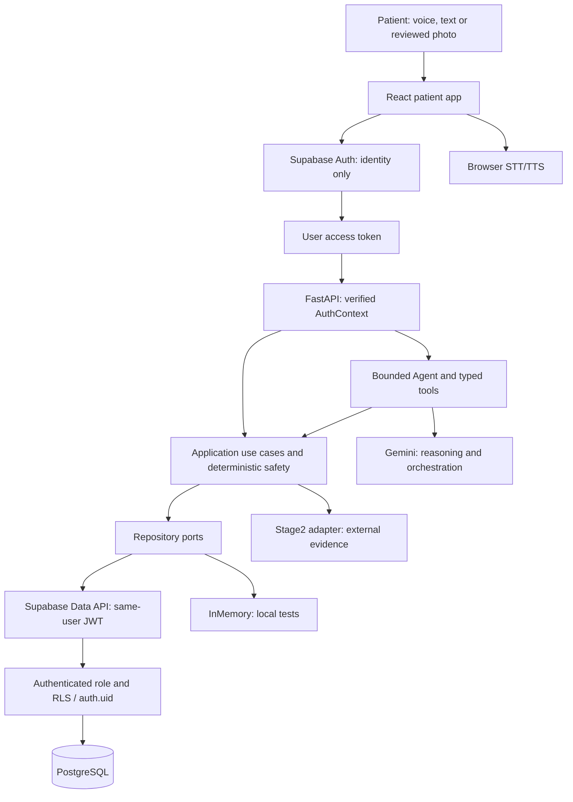

# PharmaScan Care

**A voice-first agent for safer medication routines.**

A mobile-first medication and self-care companion by Team PharmaScan, developed for the Tencent Cloud Hackathon 2026 healthcare track, Challenge 2: *AI Healthier Every Day: Intelligent Support for Long-Term Self-Care*.

PharmaScan Care helps patients organise reviewed medication instructions, review daily schedules, ask contextual questions, check medication-photo evidence, record their own medication-taking reports and prepare medication and health summaries. English and Simplified Chinese, voice and typed input, readable text and large touch targets support patients who find conventional medication forms difficult to use.

## Contents

- [Local setup and startup](#local-setup-and-startup)
- [Configuration reference](#configuration-reference)
- [Project and patient experience](#project-and-patient-experience)
- [Current capability status](#current-capability-status)
- [Repository structure](#repository-structure)
- [Architecture and safety](#architecture-and-safety)
- [Agent, context and quotas](#agent-context-and-quotas)
- [Voice providers and cost](#voice-providers-and-cost)
- [Stage2 and source evidence](#stage2-and-source-evidence)
- [Verification](#verification)
- [Limitations and acceptance](#limitations-and-acceptance)
- [Documentation map](#documentation-map)
- [Development and submission](#development-and-submission)

## Local setup and startup

### Prerequisites

- Python **3.11+**, using an existing virtual environment or Conda environment.
- Node.js **20.19+ or 22.12+** and npm, as required by current Vite.
- One terminal. Chrome/Edge are the principal voice-acceptance browsers; speech support is feature-detected.

Reuse existing environments/configuration. Dependencies are in [pyproject.toml](pyproject.toml) and [frontend/package.json](frontend/package.json), with a frontend lockfile.

### First-time installation

From the repository root, using PowerShell:

```powershell
py -3.11 -m venv .venv
.\.venv\Scripts\Activate.ps1
python -m pip install -e ".[dev]"
```

If using an existing Conda environment, activate it instead of creating another environment. Create server configuration only if absent:

```powershell
if (!(Test-Path .env)) { Copy-Item .env.example .env }
```

Choose the runtime profile deliberately:

| Profile | Backend configuration | Frontend identity configuration |
|---|---|---|
| **Patient persistence** | `PERSISTENCE=supabase`, `AUTH_MODE=supabase`, valid Supabase URL/publishable key and prepared schema. | Matching Supabase URL/publishable key in `frontend/.env.local`. |
| **SIMULATED local demo/tests** | `PERSISTENCE=in_memory`, `AUTH_MODE=demo`, `MODEL_PROVIDER=deterministic`. Restart loses memory records. | Supabase identity variables are unnecessary for this isolated profile. |

The development patient runtime uses Supabase persistence. For a fresh setup, configure the persistent profile and prepare the schema/private buckets using the [Deployment checklist](docs/DEPLOYMENT_CHECKLIST.md). The isolated local profile uses in-memory storage and deterministic replies. Code defaults to that local profile when configuration is absent.

Frontend identity configuration uses the Supabase URL and publishable key:

```dotenv
# frontend/.env.local
VITE_SUPABASE_URL=
VITE_SUPABASE_PUBLISHABLE_KEY=
```

### Daily startup

From the repository root, with the Python environment active:

```powershell
python scripts/start_dev.py
```

This starts FastAPI and Vite together. Press **Ctrl+C** to stop both. Install frontend dependencies once with `npm ci` from `frontend/` before the first launch.

The launcher reuses an installed backend environment: repository `.venv`, current Python, then the existing WorkBuddy-managed Python if available. It checks required backend imports before launching. To select another environment explicitly, add `--python "C:\path\to\python.exe"`. No dependencies are installed automatically.

If the default ports are occupied, stop your previous servers or select another pair:

```powershell
python scripts/start_dev.py --backend-port 8002 --frontend-port 5174
```

Open [localhost:5173](http://localhost:5173). API docs: [127.0.0.1:8001/docs](http://127.0.0.1:8001/docs). Health: [127.0.0.1:8001/api/health](http://127.0.0.1:8001/api/health). The launcher points Vite's `/api` proxy to the selected backend port. It uses existing configuration and starts only local servers; dependencies and database migrations remain separate setup steps.

Anonymous records are associated with the browser Auth session, so use the same origin/session when returning to the app. Expired Agent conversations renew on reload while retaining patient identity and history. For connection errors, check the backend, proxy and displayed HTTP status, then retry.

## Configuration reference

[.env.example](.env.example) is the server template. Process environment takes precedence over local `.env`; `PHARMASCAN_ENV_FILE` selects another file. Reuse existing local configuration and restart backend/Vite after changing their respective settings.

| Setting | Purpose / boundary |
|---|---|
| `PERSISTENCE`, `AUTH_MODE` | Same-user Supabase or explicitly simulated local mode. Persistent patient mode requires Supabase Auth. |
| `SUPABASE_URL`, `SUPABASE_PUBLISHABLE_KEY` | Server identity verification and user-JWT Data API. |
| `DATABASE_URL` | Administrative operations only; unnecessary for patient runtime. |
| `APP_ENV`, `APP_ORIGIN` | Runtime environment/origin. |
| `MODEL_PROVIDER` | `gemini` or explicit `deterministic` degraded/local operation. |
| `GEMINI_API_KEY`, `GEMINI_MODEL` | Server-only key/model; current model `gemini-3.5-flash-lite`. |
| `GEMINI_THINKING_LEVEL` | Current bounded demo uses `low`. |
| `DEMO_AGENT_DAILY_TURN_LIMIT` | Default 20 successful LLM-assisted turns per patient/Singapore day. |
| `GEMINI_COMPARISON_MODEL` | Optional manual comparison; no automatic model upgrade. |
| `VISION_API_BASE_URL` | Stage2 endpoint; unavailable/unsupported evidence is explicit. |
| `STT_PROVIDER`, `TTS_PROVIDER` | Both default to `browser`; browser TTS makes no synthesis HTTP request. |
| `ENABLE_SPEECH`, `TENCENT_SPEECH_APPROVED` | Existing optional cloud-speech permission gates. |
| `TENCENT_SECRET_ID`, `TENCENT_SECRET_KEY`, `TENCENT_SPEECH_SITE`, `TENCENT_TTS_VOICE_TYPE` | Optional server-only Tencent adapter settings, never React/Vite credentials. |
| `VITE_SUPABASE_URL`, `VITE_SUPABASE_PUBLISHABLE_KEY` | Frontend identity-only configuration, not business-table access. |

Store server credentials in the local backend environment. Frontend configuration uses publishable identity settings; patient requests use the authenticated user token. See [Architecture](docs/ARCHITECTURE.md) for credential and ownership boundaries.

## Project and patient experience

PharmaScan Care connects medication instructions, treatment courses, daily dose tracking and patient questions in one application. Patients can review their original instructions, distinguish current and completed courses, and discuss a specific medication across follow-up questions.

The app is designed for adults managing oral medications in Singapore, with voice interaction, larger text and simplified controls for older users.

The medication lifecycle connects four activities:

1. **Register and review:** start with a package/label photo or enter instructions manually, review source evidence and missing fields, then explicitly confirm activation of a versioned regimen.
2. **Prepare references:** keep product identity and reference eligibility separate from instructions. Save private reference photos, retain source associations and compare eligible loose-pill references with real Stage2 embeddings.
3. **Daily support:** see scheduled/PRN medication information, ask the companion, review photo evidence, snooze reminders and explicitly confirm a self-report.
4. **Review over time:** inspect patient reports and optional health notes, then view/export week, month or course summaries for a real-world professional discussion.

| Destination | Current patient experience |
|---|---|
| **Today** | One overview lists every current medicine with dose/time; tap a medicine, swipe the shared detail area or use previous/next. Expand the selected medicine's actions to compare a pill photo, prepare an intake report or snooze a reminder. |
| **Medicines** | Current/upcoming medications, historical courses, unfinished registration and separate label/manual-add workflows. Personal gallery is grouped by product, with private thumbnails and current/historical courses. |
| **Assistant** | Contextual questions, editable speech transcripts, typed fallback, response playback and separate consequential-action confirmation. Send stays beside the microphone in the composer; empty messages cannot be sent. |
| **History** | Patient-reported taken/not taken/unsure records, optional reviewed health notes and patient-initiated summary/export. |
| **Me** | Independent profile, account, reminders, language/speech, accessibility, privacy, About and feedback pages. |

The UI keeps PharmaScan's teal identity, fixed header Back control and mobile navigation. Its main design target is 390–430px portrait, with desktop support and accessible text/touch controls. Technical diagnostics are available through secondary views.

First visit opens a short English/Chinese guide once records have loaded. White coach marks explain Today, Medicines, photo input, microphone/transcript/Send, dose confirmation, voice defaults and the account menu. Skip or finish remembers dismissal in this browser; reopen it from **Me → Quick start guide** or **Settings → Quick start guide**. The guide reads current preferences and never changes them. Automatic reading remains off by default; use **Settings → Language and speech → Read replies automatically** to enable it.

The header provides a gear for Settings and a person icon for Me, labelled with the current Auth account state. It shows a guest/member/local-demo state without displaying email or internal identifiers. Guide completion is browser-local and contains no patient data.

**Settings → Accessibility → Text size** uses a numeric **100–150%** slider. All interface text, including headings, buttons, navigation, messages and dialogs, scales together. Changes preview while dragging and save to the authenticated patient profile on release or keyboard adjustment; reload restores the value. Existing Standard/Large settings map to 100/125%. At large sizes content can scroll rather than being clipped; the header/navigation and composer spacing adapt to their measured height.

## Current capability status

| Capability | Implemented behavior | Evidence / limit |
|---|---|---|
| Persistence and isolation | Verified AuthContext, same-user JWT Data API, RLS and private Storage ownership. | REAL LIVE A/B isolation verified. |
| Medication registration | Draft → source review → activation challenge → explicit activation → list/refetch/reload. | REAL LIVE persistence and browser checks. |
| Courses/scheduling | Reviewed dose/unit, daily/selected-weekday times, PRN, start/end dates and food instructions. End date is inclusive. | Patient reviews dose, schedule and course instructions. |
| Dose self-report | Independent confirmation sheet, atomic event/challenge consumption and retry-safe idempotency. | REAL LIVE B14, cancellation and retry checks. |
| Agent | Gemini Interactions/function calling through typed tools, with deterministic fallback. | Personalised Gemini path: REAL LIVE. Health-note model tool: local tests; provider acceptance pending. |
| Preferences/memory | Persisted language/accessibility/reminder preferences; bounded owned context/recent conversation. | A/B/reload checks recorded; expired conversation rotation preserves patient records. |
| Voice | Browser STT → transcript review → Send → Agent → Browser TTS. | AUTOMATED/SYNTHETIC checks; physical microphone, available voices and audible pronunciation MANUAL PENDING. |
| Tencent TTS | Optional authenticated server-side provider, explicit selection and server permission. | English/Mandarin provider WAV verified; optional and disabled by default. |
| Visual/source evidence | Separate Check this dose / Identify a pill / Add information; progressive multi-source registration and conflict handling. | REAL browser Gemini/Supabase/Stage2 Demo A/B/C verified with synthetic inputs. PDF extraction unavailable. |
| Personal gallery | Private photo persistence, eligible loose-pill embeddings, same-user personal matching, course reconciliation and retirement. | REAL LIVE synthetic references/matching and browser reload verified; packaging/blister automatic matching unavailable. |
| Reminders | Occurrence-bound snooze, server-derived due alerts, in-app prompts and optional browser notifications. | Active/reopened app only; no reliable closed-browser delivery. |
| Health summaries | Reviewed health-note CRUD; deterministic week/month/course summaries from stored records. | Summarises stored schedules, reports, health notes and unresolved items. |
| Account/feedback | Anonymous Auth, email OTP/Magic Link/password UI and private persisted feedback. | Email delivery/linking MANUAL PENDING; real Singpass/caregiver delivery not integrated. |
| Caregiver contacts | Me → Caregiver contacts supports private add/edit/delete/reload with explicit storage permission. REAL LIVE Supabase A/B isolation verified. | Contacts remain unverified; no account linking, invitation, notification or record access is enabled. |

## Repository structure

```text
pharmascan-care-agent/
├── README.md                         # Current project entry point
├── PharmaScan_Care_Master_Hub.html   # Bilingual interactive planning hub
├── PROJECT_BRIEF.md                  # Specification index
├── pyproject.toml                    # Python package, dependencies, Ruff/Pytest
├── .env.example                      # Safe server configuration template
├── backend/
│   ├── app/
│   │   ├── contracts/                # Typed DTOs, repository/provider ports
│   │   ├── domain/                   # Domain validation, errors and safety policy
│   │   ├── application/              # Enrollment, doses, reminders, records
│   │   ├── agent/                    # Orchestration, tools, context/model loop
│   │   ├── infrastructure/           # Memory, Supabase and provider adapters
│   │   ├── transport/                # FastAPI routes, auth and DI composition
│   │   └── config.py                 # Injected configuration; secrets hidden
│   └── integrations/                # External integration notes/contracts
├── frontend/
│   ├── src/
│   │   ├── api/                      # Typed HTTP client; identity-only Auth
│   │   ├── components/               # Patient screens and shared controls
│   │   ├── browserSpeech.ts          # Native STT lifecycle
│   │   ├── browserTts.ts             # Native TTS; no paid fallback
│   │   ├── language.tsx              # Language and playback UI context
│   │   └── App.tsx                   # Navigation and patient integration
│   ├── public/                       # App icon and PWA manifest
│   ├── e2e/                          # Playwright browser scenarios
│   └── package.json                  # Frontend scripts/dependencies
├── supabase/
│   ├── migrations/                   # Versioned PostgreSQL migrations 001–020
│   └── rollback/                     # Corresponding rollback definitions
├── scripts/                          # Explicit DB setup/verification utilities
├── tests/                            # Backend/domain/contracts/live regressions
│   └── fixtures/stage2/              # Versioned contract evidence
├── docs/                             # Canonical detailed documentation
│   ├── external/                     # Frozen Stage2 OpenAPI snapshots
│   └── reference/                    # Historical design/source references
└── assets/                           # Local submission media (ignored; not required to run)
```

Local development records live in `status/`, `prompts/`, `outputs/` and `evidence/`, following the existing publication policy. Generated environments, caches and dependency directories are omitted from this tree.

## Architecture and safety

The stack is React/TypeScript/Vite, FastAPI/Pydantic, Supabase Auth/PostgreSQL/private Storage, Gemini and an independently maintained PharmaScan Stage2 service. Browser speech is the default; Tencent adapters remain optional infrastructure.



Normal patient data follows **React → Supabase Auth → user token → FastAPI → verified AuthContext → Application → Repository Port → same-user JWT Data API → authenticated role → RLS → PostgreSQL**.

FastAPI derives patient identity from verified authentication. Frontend Supabase access handles login; business CRUD goes through application services and repository ports. The Agent accesses business capabilities through typed tools.

`DATABASE_URL` is reserved for administrative migrations, schema verification and controlled diagnostics. Patient requests use same-user JWT access with RLS. Private `medication-sources` and `visual-references` buckets enforce ownership.

Dose reporting must follow:

```text
Typed/spoken request → resolve occurrence → record_self_report challenge
→ human-readable summary → explicit Confirm
→ atomic dose_event + consume challenge → History
```

Confirmation writes one retry-safe event; cancellation leaves records unchanged. `reported_taken` records the patient's own report. Visual resemblance, reported intake and unrecorded doses are represented separately. See [Safety and evaluation](docs/SAFETY_AND_EVALUATION.md) for their clinical meaning.

See [Architecture](docs/ARCHITECTURE.md), [API contracts](docs/API_CONTRACTS.md), [Data model](docs/DATA_MODEL.md) and [Safety and evaluation](docs/SAFETY_AND_EVALUATION.md).

## Agent, context and quotas

Gemini interprets conversations and selects typed application tasks. The official Google GenAI SDK Interactions integration uses `store=false`, `thinking_level=low`, application-owned context and at most **four tool rounds**.

The exact model tool allowlist is:

```text
list_active_medications    check_due_dose
get_dose_status           get_medication_history
prepare_self_report       create_reminder
check_medication_image    prepare_health_observation
reconcile_medication_sources
```

The backend supplies verified patient identity and validates each tool call. `prepare_self_report` returns a B14 confirmation challenge; `prepare_health_observation` returns a note for patient review. Explicit patient actions complete the corresponding record writes.

Versioned context retains at most six recent turn pairs, a bounded summary and references established by verified tool results. It supports “Did I already take it?” and medication-choice clarification. Permanent preferences are managed by explicit application actions.

App and provider quota are separate. Atomic accounting limits successful LLM-assisted turns per `auth.uid()`, resetting at **00:00 Asia/Singapore**; model requests are accounted separately. Failed provider calls release their turn reservation. Provider capacity can be exhausted before an individual's quota; non-AI medication features remain usable.

## Voice providers and cost

Default: **microphone → Browser SpeechRecognition → editable transcript → explicit Send → normal Agent/tools/safety → response text → Browser SpeechSynthesis**. English STT uses `en-SG`; Chinese uses `zh-CN`. One persisted preferred language drives UI, recognition locale and Agent output.

Browser TTS uses `getVoices()`/`voiceschanged`, selecting actual language-qualified voices. Prefer `localService`, then Singapore locale within that group: English `en-SG` with available English fallback; Mandarin `zh-SG`/`zh-CN`. When a matching voice is unavailable, the app keeps the text response available. Speed defaults to **0.9x**, adjustable **0.7–1.2x**. Play/Stop/replay/future-reply autoplay are supported; new messages/navigation/language/provider changes cancel stale playback. Failure preserves visible text.

Browser synthesis makes no Tencent API request. Browser recognition and some voices use remote services, depending on the device. Typed input remains available.

Cloud TTS requires **both** deliberate server enablement (`TTS_PROVIDER=tencent`, `ENABLE_SPEECH=true`, `TENCENT_SPEECH_APPROVED=true`, valid server credentials) **and** explicit patient Cloud selection in Me → Language and speech. Selection resets to Browser on reload. Requests require `provider=tencent` and consent; Browser failure never selects Cloud. Tencent/Gemini calls can incur provider usage charges. Standalone Tencent ASR remains inactive with `STT_PROVIDER=browser`.

## Stage2 and source evidence

Stage2 is an independently maintained, stateless image service. The runtime now injects the supplied [v0.10.0 OpenAPI contract](docs/external/pharmascan-api-openapi-0.10.0.json); older snapshots are retained. The [upgrade evidence and contract diff](docs/STAGE2_V010_UPGRADE.md) distinguish API version from model/embedding compatibility. Source, gallery and read-only visual gateways use the same explicit contract.

**Compare a pill photo / 拍照核对药片** opens camera/upload, preview and consented evidence checking. The page explains what the photo is used for and the limits of its result. Results include visual similarity and candidate evidence. Detector counts are used when `count_reliable=true`; query/reference model, embedding space and preprocessing must agree. Inadequate evidence or ineligible references return unknown/ambiguous.

Read-label retains `Printed.value`/`Printed.line`, structured Singapore sticker instructions and field-level provenance. Parsed dose/unit, daily frequency, interval, PRN, food, duration and maximum remain unreviewed source evidence. Daily count does not invent clock times; dispensing/expiry dates and supply quantity never establish a course. Conflicting strength/release/product code or printed instructions blocks activation. The image-routing helper offers a workflow suggestion without executing provider tool names. Product strength is separate from personal dose. Patients review extracted evidence, complete missing dose/schedule/course/food instructions, and explicitly activate the regimen. See [Stage2 API gaps/owner handoff](docs/STAGE2_API_GAPS.md).

### Progressive registration and personal references

Package and patient instructions can arrive separately. Read medication information saves a durable candidate identity and original source evidence, asks for missing instructions, then accepts another label in the same registration. Gemini calls `reconcile_medication_sources`; deterministic reconciliation retains disagreements and blocks activation. Continue saved tasks from Medicines after reload. Generic-name/printed-strength suffix formatting is compared separately from actual strength/form. A repeated medicine name prompts selection of the existing product or explicit confirmation of a distinct product; it does not merge records automatically.

Review dose/unit, schedule, food and course dates, then explicitly activate. Explicit finite source duration cannot become an open-ended plan by leaving dates blank. A new course reuses the selected identity and preserves previous regimen versions. Product categories POM/P/GSL/supplement remain patient-entered unless independently verified; unknown stays unknown.

Personal gallery stores packaging, blister and loose-pill photos privately. Only reviewed, compatible loose-pill references enter `/v1/embed` -> `/v1/match`; product association and current regimen are checked separately. Retiring a photo removes it from matching while retaining source/history. Packaging/blister photos are viewable references without automatic matching. PDF ingestion is not implemented; use a source image or manual entry.

For this API upgrade, see [v0.10 Demo A/B/C acceptance](docs/STAGE2_V010_UPGRADE.md#reproducible-acceptance); older journey results below are historical and do not verify the upgraded runtime.

[Reproducible earlier Demo A/B/C and screenshots](docs/WORKFLOWS.md#current-progressive-evidence-and-gallery-workflows) cover progressive evidence, actual personal matching and conflict follow-up. Identical synthetic query/reference images test integration, not medication-recognition accuracy. [Stage2 owner gaps](docs/STAGE2_API_GAPS.md) track extraction needs; [knowledge-source review](docs/MEDICATION_KNOWLEDGE_SOURCES.md) records future research.

## Verification

Repository root, Python environment active:

```powershell
$env:PYTHONPATH = 'backend'
python -m pytest -q --tb=short -p no:cacheprovider
python -m ruff check .
git diff --check
```

From `frontend/`:

```powershell
npm run lint
npm run typecheck
npm run test
npm run build
npm run test:browser -- e2e/browser-tts.spec.ts
```

Playwright defaults to a local Chrome executable and QA URL. Override `PLAYWRIGHT_CHROMIUM_EXECUTABLE` for Edge/other Chromium and `QA_BASE_URL` for your frontend. Live journeys require `RUN_LIVE_BROWSER=1`; Supabase/Stage2/model tests have separate opt-ins. Inspect selected tests before enabling external calls: some create synthetic records or consume provider quota.

Latest recorded checks (15 October 2026):

| Check | Recorded result / evidence |
|---|---|
| Full backend local suite | **608 passed, 20 skipped, 1 warning**; VERIFIED LOCAL (dependency deprecation; cache disabled). |
| Ruff; frontend lint/typecheck/build | Passed; VERIFIED LOCAL. |
| Frontend Vitest | **95 passed, 19 files**; VERIFIED LOCAL. |
| Expired-session reload | REAL LIVE Supabase: successful renewal, same patient identity, existing history preserved. |
| Chrome `localhost:5173` initial/reload | Authenticated API, same patient identity, record endpoints 200, zero error banners; synthetic patient. |
| Chrome/Edge TTS | **1 passed each**; AUTOMATED/SYNTHETIC service events, native API present but headless voice lists empty. |
| Earlier pre-0.10 full suite with real Auth/RLS/B14/Storage/Stage2 enabled | **586 passed, 1 skipped, 1 warning** (before final source-display/course refinements). Final scoped gallery/source RLS rechecks and current local suite follow those refinements. |
| Earlier pre-0.10 gallery/source integration | **2 passed, 16 deselected**; owner JWT, private files, actual embed/match, logical retirement and A/B source isolation. |
| Private gallery thumbnails | Real browser/Auth/DB/Storage: **1 passed (1.2m)**, decoded pictures and reload at390/430px/desktop. |
| Earlier Demo A/B/C | Real Chrome + Gemini + Supabase + Stage2, synthetic inputs; **1 combined scenario passed (4.4m), before the 0.10 upgrade**. |

Current0.10 verification: real Supabase regression **16 passed,3 skipped,1 warning** (extra Stage2 opt-ins off); additional real source/gallery A/B **2 passed,17 deselected,1 warning** with Stage2 opt-in; real Chrome/Gemini/Supabase/Stage2 Demo A/B/C plus Chinese preference/reload **1 passed (8.3m)**. The synthetic reference/query pair returned actual `/v1/match` evidence, with `imprint_check=not_checked`, `safe_to_take=false` and `ingestion_proven=false`. This tests integration, not recognition accuracy. Metadata probes, two initial label extractions, one explicit package routing probe and one limited safety coverage probe are separately recorded in [upgrade evidence](docs/STAGE2_V010_UPGRADE.md).

Browser automation covers speech event handling and playback controls. Physical microphone, speaker and medication pronunciation checks are listed below.

## Limitations and acceptance

- **Manual acceptance:** English/Mandarin microphone and speaker, medicine/dose pronunciation, mobile keyboard, email delivery and account linking.
- **Partial workflows:** caregiver verification/account linking/notifications, PDF ingestion, professional source authentication and whole-package/blister automatic matching. Private caregiver contact management is available. Legacy same-name identities and contradictory-document disposition need explicit review; records are preserved.
- **Delivery:** reminders operate while the app is open or reopened. Closed-browser push, SMS and caregiver delivery are planned extensions.
- **Data coverage:** the app uses online patient APIs; summaries cover stored schedules, reports and notes. Oversized summary queries ask for a shorter period.
- **Future capabilities:** knowledge retrieval, structured BP/glucose trends, preventive tasks, hospital/NEHR integration and Singpass.
- **Release work:** hosting configuration, deployment smoke tests, licence review and submission artefacts.
- **Clinical validation:** the current demo uses synthetic records; clinical validation remains a separate workstream.

Manual demo acceptance should cover registration/review/activation/reload; Today and “it” follow-up; uncertainty without intake mutation; Taken → cancel/Confirm → History; en/zh transcript editing/playback; real photo evidence and safe degradation; reminders/notification denial; health-note review/summary export; A/B isolation and quota degradation.

See [Deployment checklist](docs/DEPLOYMENT_CHECKLIST.md) and [Safety and evaluation](docs/SAFETY_AND_EVALUATION.md).

## Documentation map

| Document | Purpose |
|---|---|
| [Interactive Master Hub](PharmaScan_Care_Master_Hub.html) | Bilingual project narrative, lifecycle diagrams and submission planning; open locally in a browser. |
| [Project brief](PROJECT_BRIEF.md) | Product and engineering specification index. |
| [Master specification](docs/MASTER_SPEC.md) | Target users, intended use, challenge requirements and designed capabilities. |
| [Workflows](docs/WORKFLOWS.md) | Detailed medication lifecycle, tool and state flows. |
| [Architecture](docs/ARCHITECTURE.md) | Component ownership, dependencies and patient trust boundary. |
| [API contracts](docs/API_CONTRACTS.md) | Typed public APIs and external adapter boundaries. |
| [Data model](docs/DATA_MODEL.md) | Identity/version/provenance, schedules/events and ownership. |
| [Safety and evaluation](docs/SAFETY_AND_EVALUATION.md) | Abstention, privacy, clinical meaning and evaluation boundaries. |
| [Decision log](docs/DECISION_LOG.md) | Engineering decisions and implementation rationale. |
| [Medication knowledge sources](docs/MEDICATION_KNOWLEDGE_SOURCES.md) | HSA/DailyMed/MedlinePlus/DDInter access, licence and coverage research. |
| [Stage2 API gaps](docs/STAGE2_API_GAPS.md) | Structured extraction gaps and external-owner handoff. |
| [Deployment checklist](docs/DEPLOYMENT_CHECKLIST.md) | Environment/account/manual smoke/release gates. |
| [Frontend guide](frontend/README.md) | UI scripts, identity configuration and browser testing. |
| [Build plan](docs/BUILD_PLAN.md) | Development stages and acceptance gates. |
| [Submission](docs/SUBMISSION.md) | Pitch, submission requirements and artefacts. |
| [AI development log](docs/AI_DEVELOPMENT_LOG.md) / [WorkBuddy guide](docs/WORKBUDDY_GUIDE.md) | Development methodology and evidence collection. |

Local session logs, QA results and task tracking are maintained in `status/WORK_LOG.md`, `status/FINAL_QA.md`, `status/BLOCKERS.md` and `status/tasks.json`.

## Development and submission

Local submission media (`assets/`), QA output/screenshots, uploads, internal status/prompts, tool workspaces and credential files are excluded from Git. Keep them locally or distribute approved submission media separately. Application source, `frontend/public/` icons/manifest, dependency lockfiles, schema migrations, synthetic test fixtures and public documentation remain versioned.

Read applicable repository engineering guidance, including `AGENTS.md` when present. Preserve clean architecture, injected dependencies, strict schemas, versioned source provenance, patient ownership and confirmation/idempotency tests. Change business behavior through typed application use cases/ports, keeping credentials and administrative utilities outside the patient path.

Use synthetic `demo_only` records/images. Keep unrelated local changes and publication policy; never force-add excluded state or commit real `.env` files. Coordinate external Stage2 contract changes with its owner.

The [Hub](PharmaScan_Care_Master_Hub.html) and [Submission guide](docs/SUBMISSION.md) organise the project pitch and submission package: title/blurb, description, cover, source repository, demo/video, architecture diagram and WorkBuddy/CodeBuddy development-chat evidence.
