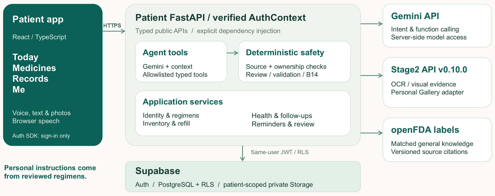
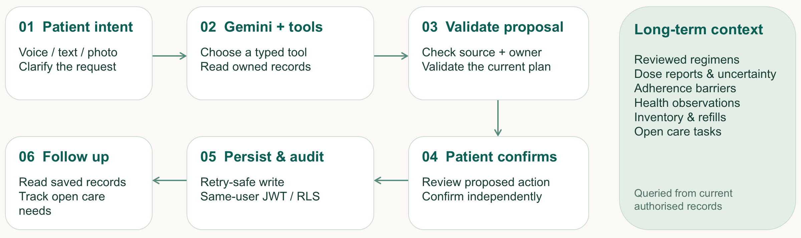

<p align="right"><a href="README.md">English</a> · <strong>简体中文</strong></p>

<h1 align="center">MediThread</h1>

<h2 align="center">从今天的用药，到下一次复诊。</h2>

<p align="center">
  一个以语音交互为优先设计的用药助手，连接已核对的用药计划、日常照护记录和复诊准备。
</p>

<p align="center">
  <a href="https://medithread.vercel.app"><strong>打开 MediThread ↗</strong></a>
  &nbsp;·&nbsp;
  <a href="#主要功能">了解功能</a>
  &nbsp;·&nbsp;
  <a href="#本地运行">本地运行</a>
</p>

<p align="center"><strong>了解药物</strong> · <strong>记录日常照护</strong> · <strong>准备复诊</strong></p>

---

## 为什么开发 MediThread？

长期用药不只是记住每天何时服药。用药指示可能变化，患者会产生新的疑问，而日常发生的细节也很难在下次就诊时完整回忆。

MediThread 将药物资料、患者自述记录和待咨询问题整理在同一应用中。助手帮助患者查询这些记录，并结合有来源的药物知识作出解释；个人用药指示与实际记录则分别保存。

## 主要功能

| | 功能 | 可以完成什么 |
|:--:|---|---|
| 01 | **了解药物** | 询问药物的一般用途，并查看可用药品说明及其来源。 |
| 02 | **管理用药计划** | 登记药物、核对来源文件与用药指示，查看当前及历史计划。 |
| 03 | **记录服药情况** | 报告**已服、未服或不确定**，回顾历史，并记录用药困难。 |
| 04 | **跟踪健康与后续事项** | 记录测量结果、身体感受、库存问题、补药需求及用药相关跟进事项。 |
| 05 | **与助手连续对话** | 使用文字或设备支持的语音询问药物与照护问题，重新打开已保存的会话。 |
| 06 | **准备复诊** | 整理用药变化、服药记录、健康观察和待咨询问题，导出复查摘要。 |

**记录与推断必须分开。** 某次计划服药尚未获得患者报告，属于**未记录**，不能自动判断为**未服药**。一般药物知识也不等于患者个人已核对的用药指示。

## 应用体验

四个照护页面与独立助手工作区共同支持日常使用。

| 区域 | 主要用途 |
|---|---|
| **今日（Today）** | 查看当天用药安排、报告服药情况，并跟进相关事项。 |
| **药物（Medicines）** | 查看药物身份、产品信息、来源证据、用药计划和库存。 |
| **记录（Records）** | 回顾服药事件、健康观察、用药困难及复查总结。 |
| **我（Me）** | 管理账户信息、个人偏好、无障碍设置和聊天记录保存。 |
| **AI 助手（Assistant）** | 询问药物与长期照护问题，并在独立保存的会话中继续对话。 |

### 可以继续的历史对话

当前开发分支已经支持新建独立会话、重新打开已保存的对话，并结合有限的历史上下文继续提问。Today 与完整 Assistant 工作区共享会话状态。没有可信会话归属的旧消息仍可只读回看。

对于当前用药计划等可能变化的信息，助手会重新查询，而不会将旧对话中的内容一直当作最新事实。

## 工作原理

### 系统架构



**图 1：系统组件与信任边界。** React 患者应用通过已认证的 FastAPI 访问业务服务。受限 Agent 工具和应用服务执行患者归属、来源核验及用药计划规则；Supabase 保存患者所属记录与私有文件，Gemini、Stage2 和 openFDA 通过后端集成访问。个人用药指示来自已核对的计划，不能由一般药品说明代替。

### Agent 流程与长期上下文



**图 2：从患者请求到后续跟进。** Agent 理解请求，通过类型化工具查询已授权记录。只读请求可以直接返回有依据的解释；敏感修改必须先通过校验，再由患者独立确认，之后才进行可安全重试的保存与审计。后续跟进重新查询当前授权记录；有界聊天上下文支持连续对话，但不替代可信的医疗业务记录。

实现细节见[系统架构](docs/ARCHITECTURE.md)、[API 契约](docs/API_CONTRACTS.md)、[数据模型](docs/DATA_MODEL.md)和[安全与评估](docs/SAFETY_AND_EVALUATION.md)。

## 技术栈

| 层级 | 技术 |
|---|---|
| **患者应用** | React 18、TypeScript、Vite |
| **后端** | Python、FastAPI、Pydantic v2 |
| **身份与数据** | Supabase Auth、启用 RLS 的 PostgreSQL、私有 Storage |
| **AI 助手** | Gemini 工具调用、有界上下文、确定性安全校验 |
| **药物资料** | 带有来源链接的 openFDA 药品说明 |
| **视觉流程** | 文件/OCR、个人照片参考、外部 Stage2 适配器 |
| **语音** | 浏览器语音识别与合成；可选腾讯云集成 |
| **托管** | Vercel 前端、Render API、独立 Web Push Dispatcher |

## 开发状态

**2026 年 10 月 18 日 · 开发分支**

- **会话连续性：** 已在本地 API、PostgreSQL 和浏览器环境验证，Supabase Migration `026` 已执行。
- **日期正确性：** 本地修复保留患者当地日期和历史用药计划关联。最新本地患者问答审查 **30 项中通过 10 项、未通过 20 项**；未解决行为见[Deferred Work](docs/DEFERRED_WORK.md)。这不代表真实 Provider 或生产环境已验证。
- **待发布与验证：** Migration `028` 已通过本地测试，但尚未在生产执行。更新后的前后端代码也尚未部署；药物知识问答、多轮澄清、记录呈现与线上集成验收仍在继续完善。

因此，[线上应用](https://medithread.vercel.app)可能仍为较早版本。功能验收范围见 [Challenge 2 工作流程](docs/CHALLENGE2.md)，发布检查见[部署清单](docs/DEPLOYMENT_CHECKLIST.md)。

## 本地运行

**环境要求：** Python 3.11+、Node.js 22.12+ 和 npm。以下命令在仓库根目录的 Windows PowerShell 中运行：

```powershell
python -m venv .venv
.venv\Scripts\Activate.ps1
python -m pip install -e ".[dev,push]"
Copy-Item .env.example .env
Copy-Item frontend/.env.example frontend/.env.local
npm --prefix frontend ci
python scripts/start_dev.py
```

启动前根据本地运行模式配置环境变量。具体配置和测试方法请参考[开发指南](docs/DEVELOPMENT.md)。

**更多文档：** [项目结构](docs/PROJECT_STRUCTURE.md) · [对话持久化](docs/CONVERSATIONS.md) · [提醒](docs/REMINDERS.md) · [Render 部署](docs/RENDER_DEPLOYMENT.md) · [服务入口](deploy/README.md)

## 仓库结构

```text
pharmascan-care-agent/
├── frontend/         React 应用及浏览器测试
├── backend/          FastAPI、Agent 与应用服务
├── supabase/         版本化数据库 Migration
├── deploy/           服务与托管配置
├── scripts/          开发与运维命令
├── tests/            后端及集成测试
├── docs/             产品与工程文档
├── README.md         英文
├── README.zh-CN.md   简体中文
└── pyproject.toml
```

## 项目与许可证

**团队：** PharmaScan
**开发者：** DING ZIXIN · Pan Shengxin
**赛道：** Tencent Cloud AI CAN DO IT Hackathon Singapore 2026 · Healthcare Challenge 2
**用户：** 长期用药的成人
**界面语言：** English / 中文

MediThread 的早期开发名称为 *PharmaScan Care*，仓库目录及部分工程记录保留了这一名称。

**项目源代码**：[Apache-2.0](LICENSE) · [NOTICE](NOTICE) · [第三方许可和数据条款](docs/legal/THIRD_PARTY_NOTICES.md)

维护导航：[Repository Guide](docs/REPOSITORY_GUIDE.md) · [逐文件目录](docs/FILE_CATALOG.md)。
