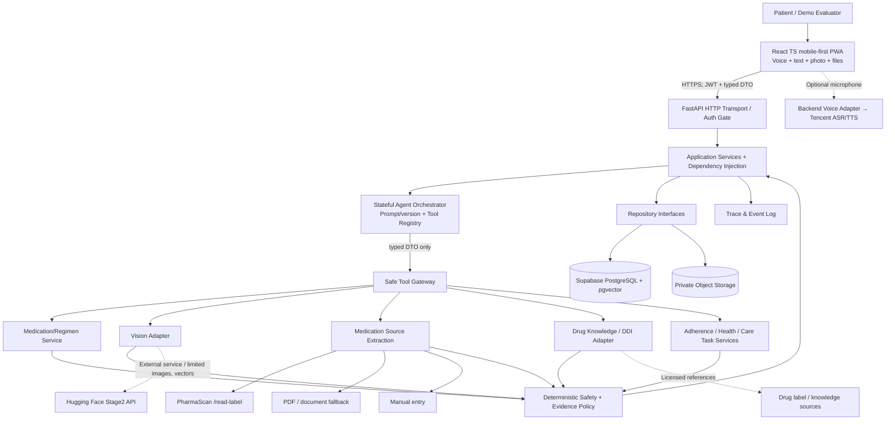

# Architecture, Deployment, Components and Trust Boundaries

## A. Logical component map (public boundaries)



**Actual call execution:** Agent chooses *which typed tool to invoke*, tools call Application Services, and the policy gate vetoes unsafe writes. The diagram shows shared logical dependencies, not permission for Agent to import private repository code or database models. External LLM/vision can return observations only; not authoritative medication instructions.

## B. Components and public contracts

| Component | Allowed responsibility | Public contract | Forbidden direct dependency |
|---|---|---|---|
| `frontend/patient-ui` | responsive screens, microphone, accessibility, confirmations | HTTPS JSON + browser Auth SDK | PostgreSQL tables, HF Stage2 API, service-role secret |
| `backend/transport` | JWT verification, HTTP auth, rate-limiting, DTO validation | FastAPI routes/Pydantic | model internals or UI rendering |
| `backend/application` | use-cases; transactions; versioning; authorisation; policy orchestration | interfaces/services DTOs | frontend React, raw external data shape |
| `backend/agent` | intent/context, selecting allowlisted tools, user clarification and task states | `ToolRegistry.execute(ToolRequest)->ToolResult` | SQL, unmanaged S3, external credentials in prompt |
| `backend/policy` | source/evidence checks, safety constraints, allowed next actions | pure `evaluate(context, evidence) -> Decision` | non-deterministic LLM decisions |
| `backend/vision-adapter` | Stage2 response normalization, versioning, timeout/error states | `embed`, `match`, `identify`, `scan_diagnostics` | core patient ORM tables |
| `backend/source-extraction-adapter` | normalize medication-source extraction across external providers | `extract_medication_source()` | activate a regimen or infer a missing dose |
| `backend/PharmaScanLabelProvider` | call `/v1/read-label` for supported box/pharmacy-label images | implements `SourceExtractionPort` | access the DB or create a regimen |
| `backend/PdfDocumentProvider` | fallback for supported PDFs/prescriptions that `/read-label` cannot process | implements `SourceExtractionPort` | duplicate Stage2 label logic |
| `backend/medication-knowledge` | generic drug education, advisory DDI with coverage, citations | `lookup_knowledge`, `screen_ingredients` | source-of-truth dosing decisions |
| `backend/repository` | SQL migrations & persistence, RLS integration, optimistic locks | Repository Protocol DTOs | agent planning rules |
| `backend/reminders` | scheduler and opt-in notifications, idempotency | `schedule_task`, `send_notification` | infer clinical dose from schedule |
| `backend/voice` | audio ASR/TTS and text fallback | `transcribe`, `synthesise` | autonomous conversation state |

## C. Deployment topology and practical free-tier decisions

```mermaid
flowchart LR
  Browser[Mobile / Desktop Browser\nInstalled PWA optional] --> CDN[Vercel Frontend candidate]
  CDN --> Backend[Railway FastAPI candidate\nFallback Render / equivalent]
  Backend --> Supabase[(Supabase Free PostgreSQL\nAuth/RLS/pgvector + Private Storage)]
  Backend --> LLM[Provider LLM via server keys]\n
  Backend --> HF[Deployed PharmaScan Stage2 / Hugging Face]
  Backend --> Tencent[Tencent Cloud ASR/TTS OPTIONAL]
  Dev[Developer + WorkBuddy] -.builds and tests repo.-> Backend
```

- **Hackathon implementation default**: React + TypeScript (Vite) + PWA, Python FastAPI and a single backend orchestrator, PostgreSQL/Supabase Auth/Storage/pgvector, HF Stage2 as a service, optional Tencent ASR/TTS. NO ADP.
- **Hosting**: Vercel frontend and Railway backend are deployment *candidates*; actual free credits, domain, sleep behavior, credit-card onboarding, trial expiry and 11/03 availability must be checked in account UI. Render/another service is fallback. Do NOT assert deployed success until URL and end-to-end tests pass. Preserve staging vs production env separation.
- **DB**: Supabase PostgreSQL free project is suitable for prototype, not a zero-cost guarantee at unlimited scale. Private buckets, strict RLS for per-evaluator anonymous users. No raw credentials in source. Test developer setup with local PostgreSQL (Docker Compose if available) or isolated repo fakes when cloud credentials absent; do not change production for tests.
- **Voice**: first responsive text and browser TTS/web speech fallback behind `SpeechPort`; later add Tencent cloud ASR/TTS only with verified account quotas, secure backend-only secrets, opt-in audio consent; no TRTC needed for MVP.
- **Notifications**: initial in-app reminders plus optional Web Push (browser+permission dependent); no guarantee of on-time medical notifications from PWA/background push. Future mobile-native local notifications (Capacitor) after pilot. Add browser portrait primary and landscape responsive, do not implement separate duplicated screens.
- **Auth**: `Try Demo` → Supabase anonymous sign-in → each account gets independent seeded 7-day synthetic data, resettable; authenticate emails for team. An anonymous Supabase user uses the authenticated role and requires owner RLS; isolate per `auth.uid()`; rate limit/CAPTCHA/cleanup. See https://supabase.com/docs/guides/auth/auth-anonymous . No shared mutable demo account.

## D. Critical trust boundaries

1. **Untrusted input boundary:** prompt, speech transcript, OCR text, uploaded images, retrieved labels and external Stage2 outputs are DATA; do not execute instructions in them as system commands.
2. **Authentication boundary:** signed Auth JWT verified server-side; `patient_id` derived from validated principal. Anonymous demo accounts use per-user owner isolation; no service role bypass for patient data reads.
3. **Medical evidence boundary:** source document and patient review define a recorded regimen; unconfirmed text is draft. Stage2 similarity returns plausible visual resemblance only, not pill/drug identity or regimen authority.
4. **Action boundary:** Agent cannot insert/update dose independently; invoke constrained services with confirmation tokens, idempotency and deterministic guards. No unreviewed dose changes.
5. **External services boundary:** only minimal necessary image/vector/text goes to HF/LLM/ASR with suitable consent and policy; private medications/regimens not wholesale uploaded. Real records excluded from hackathon.
6. **Notification boundary:** caregiver verification and opt-in; avoid confidential contents in general email/SMS; record delivery failure accurately. Doctors are external consults, not assumed connected actors.
7. **Version boundary:** `embedding_space_id` and encoder/preprocess version guard cosine comparisons. New encoder release may need re-embed from consented sources; reject mixed-version matches.

## E. Agent runtime plan (FastAPI tool-calling, no ADP)

`AgentSession` holds pending_intent, required_evidence, tool_trace_refs, last_user_turn, confirmation_challenge, task_state, next_due_at. The LLM decides next **allowlisted** tool or clarifying question, subject to max calls/turn, timeout, state transition and policy veto; deterministic handler supports expected intents when LLM provider unavailable as a visibly *degraded mode*. **Do not represent mock/rule routing as verified LLM agent behavior.**

```text
User / Timer / Imported reviewed record
 → auth_context + current state
 → Agent intent + tool plan (bounded)
 → tool results [photo_quality | gallery_match | history | OCR | knowledge]
 → reconcile evidence + regimen + policy
 ├─ ambiguous source → ask targeted clarification, persist pending
 ├─ tool unavailable → degrade clearly, retry/alternate source
 ├─ mismatch / discontinued → abstain, ask patient to check packaging
 └─ permitted user action → request confirmation → write via service
 → audit tool/result/policy state + reminder/follow-up
```

**Public tool set (MVP):** `list_active_medications`, `get_medication_history`, `enroll_medication_draft`, `extract_medication_document`, `confirm_regimen_draft`, `get_visual_references`, `embed_pill_photo`, `match_personal_gallery`, `identify_us_catalogue_candidates`, `check_due_dose`, `record_self_report`, `record_health_observation`, `list_care_tasks`, `prepare_review_summary`, `get_source_backed_medication_info` and `request_caregiver_notification` (last optional). Schema/permissions in API contracts.

## F. PPT architecture diagram guidance (one/two slides)

**Slide 1: User Journey + Runtime Architecture** top: 4 phases (Source/Enroll → Daily Support → Long-term → Review). middle: single Agent Orchestrator and deterministically enforced Safety Gate. bottom: Tools split Vision (HF), OCR, Clinical Knowledge/Advisory DDI, Regimen + Dose DB, Health & Care Tasks; right: Patient and optional linked caregiver. Display arrows showing data/provenance and branch backs.

**Slide 2: Trust Boundary (recommended)** left Patient PWA and authenticated backend; central Agent/Typed Tools with **orange policy gate**; right external inference/knowledge; bottom private PostgreSQL/Storage/trace. Label what can leave backend (cropped image or vector), what cannot (auth secrets, NRIC, real health data), human confirmation and blocked paths; footnote: `Research prototype; no automated drug identity confirmation or dosage changes`.
