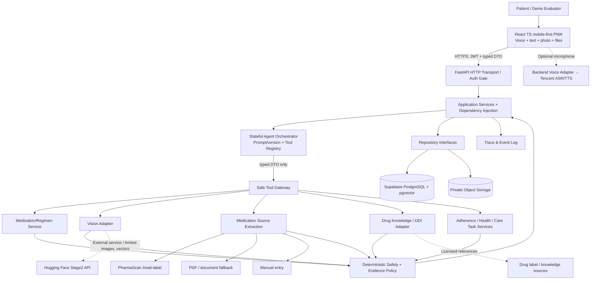

# Architecture, Deployment, Components and Trust Boundaries

## Current long-term care boundary (2026-10-16)

`LongTermCareService` composes public enrollment, observations and review summaries with read-only event/rule ports and `CareRepository`. `domain/inventory.py` contains pure balance/demand rules; stock logic is not duplicated in UI/Agent/reminders. Concrete memory and same-user-JWT adapters are injected only at `transport/container.py`. Typed DTOs are in `contracts/long_term.py`; no cross-private component imports or new patient privileged path are introduced.

Gemini's added read/prepare tools call this service. `CareReview` goes to a shared human confirmation sheet before authorized HTTP writes. Long-term truth is re-read from owned persistence across sessions; bounded conversation text is not authoritative. B14 and clinical regimen guards remain separate. Care tasks reuse `notification_deliveries`/`NotificationWorker`; no new scheduler/provider. Exact implemented interfaces and limits: [LONG_TERM_CARE](LONG_TERM_CARE.md). Component boxes later in this document include design targets: PDF/automatic caregiver delivery are not implemented. Bounded openFDA knowledge and reviewed personal instructions are implemented through the [Medication Understanding interface](../backend/MEDICATION_UNDERSTANDING.md); use the [runtime workflows](WORKFLOWS.md) for remaining runtime status.

The eleven added functions include controlled missing-field clarification. Optional bounded clarification state remains separate from dose-choice state. Clock and patient timezone are injected context metadata. Combined visit preparation requires complete review evidence; one coverage repair fits inside the unchanged four-round orchestration limit. A later narrow tool read cannot replace an already verified full review.

## A. Logical component map (public boundaries)



**Actual call execution:** Agent chooses *which typed tool to invoke*, tools call Application Services, and the policy gate vetoes unsafe writes. The diagram shows shared logical dependencies, not permission for Agent to import private repository code or database models. External LLM/vision can return observations only; not authoritative medication instructions.

## B. Components and public contracts

| Component | Allowed responsibility | Public contract | Forbidden direct dependency |
|---|---|---|---|
| `frontend/patient-ui` | responsive screens, microphone, accessibility, confirmations | HTTPS JSON + browser Auth SDK | PostgreSQL tables, HF Stage2 API, service-role secret |
| `backend/transport` | JWT verification, HTTP auth, rate-limiting, DTO validation | FastAPI routes/Pydantic | model internals or UI rendering |
| `backend/application` | use-cases; transactions; versioning; authorisation; policy orchestration | interfaces/services DTOs | frontend React, raw external data shape |
| `backend/agent` | intent/context, selecting allowlisted tools, user clarification and task states | `ToolRegistry.execute(ToolRequest)->ToolResult` | SQL, unmanaged S3, external credentials in prompt |
| `backend/policy` | source/evidence checks, safety constraints, allowed next actions | pure `evaluate(context, evidence) -> Decision` | non-deterministic LLM decisions |
| `backend/vision-adapter` | Stage2 response normalization, versioning, timeout/error states | `embed`, `match`, `identify`, `scan_diagnostics` | core patient ORM tables |
| `backend/source-extraction-adapter` | normalize medication-source extraction across external providers | `extract_medication_source()` | activate a regimen or infer a missing dose |
| `backend/PharmaScanLabelProvider` | call `/v1/read-label` for supported box/pharmacy-label images | implements `SourceExtractionPort` | access the DB or create a regimen |
| `backend/PdfDocumentProvider` | fallback for supported PDFs/prescriptions that `/read-label` cannot process | implements `SourceExtractionPort` | duplicate Stage2 label logic |
| `backend/medication-knowledge` | generic drug education, advisory DDI with coverage, citations | `lookup_knowledge`, `screen_ingredients` | source-of-truth dosing decisions |
| `backend/repository` | SQL migrations & persistence, RLS integration, optimistic locks | Repository Protocol DTOs | agent planning rules |
| `backend/reminders` | scheduler and opt-in notifications, idempotency | `schedule_task`, `send_notification` | infer clinical dose from schedule |
| `backend/voice` | audio ASR/TTS and text fallback | `transcribe`, `synthesise` | autonomous conversation state |

## C. Deployment topology and practical free-tier decisions

```mermaid
flowchart LR
  Browser[Mobile / Desktop Browser\nInstalled PWA optional] --> CDN[Vercel Frontend candidate]
  CDN --> Backend[Railway FastAPI candidate\nFallback Render / equivalent]
  Backend --> Supabase[(Supabase Free PostgreSQL\nAuth/RLS/pgvector + Private Storage)]
  Backend --> LLM[Provider LLM via server keys]\n
  Backend --> HF[Deployed PharmaScan Stage2 / Hugging Face]
  Backend --> Tencent[Tencent Cloud ASR/TTS OPTIONAL]
  Dev[Developer + WorkBuddy] -.builds and tests repo.-> Backend
```

- **Hackathon implementation default**: React + TypeScript (Vite) + PWA, Python FastAPI and a single backend orchestrator, PostgreSQL/Supabase Auth/Storage/pgvector, HF Stage2 as a service, optional Tencent ASR/TTS. NO ADP.
- **Hosting**: Vercel frontend and Railway backend are deployment *candidates*; actual free credits, domain, sleep behavior, credit-card onboarding, trial expiry and 11/03 availability must be checked in account UI. Render/another service is fallback. Do NOT assert deployed success until URL and end-to-end tests pass. Preserve staging vs production env separation.
- **DB**: Supabase PostgreSQL free project is suitable for prototype, not a zero-cost guarantee at unlimited scale. Private buckets, strict RLS for per-evaluator anonymous users. No raw credentials in source. Test developer setup with local PostgreSQL (Docker Compose if available) or isolated repo fakes when cloud credentials absent; do not change production for tests.
- **Voice**: first responsive text and browser TTS/web speech fallback behind `SpeechPort`; later add Tencent cloud ASR/TTS only with verified account quotas, secure backend-only secrets, opt-in audio consent; no TRTC needed for MVP.
- **Notifications**: initial in-app reminders plus optional Web Push (browser+permission dependent); no guarantee of on-time medical notifications from PWA/background push. Future mobile-native local notifications (Capacitor) after pilot. Add browser portrait primary and landscape responsive, do not implement separate duplicated screens.
- **Auth**: `Try Demo` → Supabase anonymous sign-in → each account gets independent seeded 7-day synthetic data, resettable; authenticate emails for team. An anonymous Supabase user uses the authenticated role and requires owner RLS; isolate per `auth.uid()`; rate limit/CAPTCHA/cleanup. See https://supabase.com/docs/guides/auth/auth-anonymous . No shared mutable demo account.

## D. Critical trust boundaries

1. **Untrusted input boundary:** prompt, speech transcript, OCR text, uploaded images, retrieved labels and external Stage2 outputs are DATA; do not execute instructions in them as system commands.
2. **Authentication boundary:** signed Auth JWT verified server-side; `patient_id` derived from validated principal. Anonymous demo accounts use per-user owner isolation; no service role bypass for patient data reads.
3. **Medical evidence boundary:** source document and patient review define a recorded regimen; unconfirmed text is draft. Stage2 similarity returns plausible visual resemblance only, not pill/drug identity or regimen authority.
4. **Action boundary:** Agent cannot insert/update dose independently; invoke constrained services with confirmation tokens, idempotency and deterministic guards. No unreviewed dose changes.
5. **External services boundary:** only minimal necessary image/vector/text goes to HF/LLM/ASR with suitable consent and policy; private medications/regimens not wholesale uploaded. Real records excluded from hackathon.
6. **Notification boundary:** caregiver verification and opt-in; avoid confidential contents in general email/SMS; record delivery failure accurately. Doctors are external consults, not assumed connected actors.
7. **Version boundary:** `embedding_space_id` and encoder/preprocess version guard cosine comparisons. New encoder release may need re-embed from consented sources; reject mixed-version matches.

## E. Agent runtime plan (FastAPI tool-calling, no ADP)

`AgentSession` holds pending_intent, required_evidence, tool_trace_refs, last_user_turn, confirmation_challenge, task_state, next_due_at. The LLM decides next **allowlisted** tool or clarifying question, subject to max calls/turn, timeout, state transition and policy veto; deterministic handler supports expected intents when LLM provider unavailable as a visibly *degraded mode*. **Do not represent mock/rule routing as verified LLM agent behavior.**

```text
User / Timer / Imported reviewed record
 → auth_context + current state
 → Agent intent + tool plan (bounded)
 → tool results [photo_quality | gallery_match | history | OCR | knowledge]
 → reconcile evidence + regimen + policy
 ├─ ambiguous source → ask targeted clarification, persist pending
 ├─ tool unavailable → degrade clearly, retry/alternate source
 ├─ mismatch / discontinued → abstain, ask patient to check packaging
 └─ permitted user action → request confirmation → write via service
 → audit tool/result/policy state + reminder/follow-up
```

**Public tool set (MVP):** `list_active_medications`, `get_medication_history`, `enroll_medication_draft`, `extract_medication_document`, `confirm_regimen_draft`, `get_visual_references`, `embed_pill_photo`, `match_personal_gallery`, `identify_us_catalogue_candidates`, `check_due_dose`, `record_self_report`, `record_health_observation`, `list_care_tasks`, `prepare_review_summary`, `get_source_backed_medication_info` and `request_caregiver_notification` (last optional). Schema/permissions in API contracts.

## F. PPT architecture diagram guidance (one/two slides)

**Slide 1: User Journey + Runtime Architecture** top: 4 phases (Source/Enroll → Daily Support → Long-term → Review). middle: single Agent Orchestrator and deterministically enforced Safety Gate. bottom: Tools split Vision (HF), OCR, Clinical Knowledge/Advisory DDI, Regimen + Dose DB, Health & Care Tasks; right: Patient and optional linked caregiver. Display arrows showing data/provenance and branch backs.

**Slide 2: Trust Boundary (recommended)** left Patient PWA and authenticated backend; central Agent/Typed Tools with **orange policy gate**; right external inference/knowledge; bottom private PostgreSQL/Storage/trace. Label what can leave backend (cropped image or vector), what cannot (auth secrets, NRIC, real health data), human confirmation and blocked paths; footnote: `Research prototype; no automated drug identity confirmation or dosage changes`.

## Session 3D: enforced persistent patient boundary (2026-10-14)

Normal persistent HTTP access uses `PERSISTENCE=supabase` (`postgres` is a compatibility alias) and requires `AUTH_MODE=supabase`. React uses the identity-only Supabase Auth SDK; business requests carry its current user access token to FastAPI. `SupabaseAuthApiVerifier` calls Auth `GET /auth/v1/user`, which verifies authenticity and expiration before deriving the UUID principal. The token is excluded from principal/config repr and diagnostic output, stays in transport/infrastructure, and is never an application/domain parameter.

`get_container` creates and caches a request-scoped service graph over `SupabaseDataClient` and the existing repository ports. Each outbound Data API call uses the SAME verified user's JWT plus publishable key. PostgreSQL runs as `authenticated`; unchanged owner policies enforce `auth.uid()`. The frontend never performs business CRUD. There is no administrative connection or DATABASE_URL fallback in this graph. The factory refuses persistent demo auth; the HTTP app refuses administrative PostgreSQL containers.

`DATABASE_URL` remains for migrations, schema verification, controlled maintenance and explicit administrative diagnostics. Migration 004's role-switch adapters remain diagnostic tools only. Migration 005 grants authenticated DML behind existing RLS/guards and moves the confirmation helper into `pharmascan_private`, outside the exposed public Data API schema. The helper remains SECURITY INVOKER; public trigger guards retain their original checks. Only the narrowly scoped `record_confirmed_self_report` operation is exposed. It derives owner identity from `auth.uid()`, serializes idempotency keys, validates replay bindings, and inserts/consumes/closes in one transaction.

Public application read methods now replace agent/transport access to private enrollment repositories. InMemory implementations remain SIMULATED for deterministic tests.

## Session 03 integration and voice gate (2026-10-14)

Speech uses authenticated FastAPI -> SpeechService -> SpeechPort -> TencentRpcTransport. The bounded server-side TC3 adapter uses SentenceRecognition (2019-06-14) and TextToVoice (2019-08-23); credentials never enter application DTOs or browser code. Browser MediaRecorder input is normalized to mono PCM16 16kHz WAV, limited to 30 seconds, and sent only after consent. The returned transcript remains editable and requires explicit Send. Agent self-report returns a typed pending challenge; only a separate Confirm writes through the existing atomic user-RLS path. Typed input remains available when speech fails. TTS audio is ephemeral, no-store, and played only on user request.

The current account's international TextToVoice endpoint with ap-singapore and standard English voice 1050 succeeded REAL LIVE through anonymous Auth/FastAPI. SentenceRecognition returned FailedOperation.UserNotRegistered on both domestic and international endpoints. This contradicts the reported activation and blocks the P0 voice gate. No real browser microphone/playback or complete voice journey is claimed. TENCENT_SPEECH_SITE selects a fixed domestic/international endpoint allowlist; no arbitrary provider URL is accepted. TENCENT_APP_ID is not an input parameter of these signed API operations.

Source preview calls the existing frozen Stage2 v0.8.0 read-label adapter through an authenticated consented endpoint. Preview is ephemeral and does not activate a regimen; manual review remains separate. Reference eligibility is a pure policy; gallery persistence, camera Smart Check and live LLM are not implemented by this slice. The Agent remains deterministic_degraded. PRN self-reports use the same challenge/consent/atomic event mechanism without manufacturing a scheduled occurrence.

## Continuation 2026-10-14: active browser recognition and immutable source evidence

This supersedes the standalone-ASR blocking decision above. Active demo STT uses native SpeechRecognition/webkitSpeechRecognition with feature detection, en-US short utterances, explicit consent, bounded lifecycle and editable review. Browsers may send audio to remote recognition services; this is not guaranteed offline/local-only or clinically reliable. Unsupported/error/denial/no-speech/abort/timeout states preserve typing. No final transcript auto-submits. Tencent SentenceRecognition remains an inactive alternative; its activation mismatch no longer blocks this demo provider choice. Tencent TextToVoice remains server-side.

Home now uses one primary medication card and a compact photo/text/microphone composer. Send is independent of recognition; pending self-report still requires separate Confirm. Audio failure preserves text. Backend source_documents.extraction_evidence (migration006) retains a bounded immutable typed extraction payload, including Printed.value/line and separate product/regimen evidence. The payload is patient-submitted untrusted evidence, not a provider-authenticated prescription. Manual dose/schedule fields remain separately reviewed; source review and activation confirmation remain mandatory. No extraction implies missing dosing fields, safety or ingestion.

PWA manifest provides install metadata only; no offline clinical workflow or reliable closed-browser push claim follows. Physical microphone acceptance remains manual pending until exercised on Chrome/Edge.

### Occurrence-bound reminder preferences

ReminderService depends on ReminderRepository/occurrence/regimen ports and injected Clock. InMemory retains deterministic tests; persistent requests inject same-user JWT SupabaseReminderRepository. Agent create_reminder is typed and allowlisted, resolves one current occurrence through check_due_dose, and never writes regimen/intake. The UI offers15/30-minute snooze; one patient/occurrence record is updated. In-app state works on active/reopened app. Background Web Push now has an independent worker/subscription implementation (configuration and device acceptance pending); SMS/caregiver delivery remain FUTURE.

## Manual acceptance repair (2026-10-14)

Vite defaults to port8001; /api/health.runtime_contract lets the frontend refuse stale backend code before authenticated setup. An unavailable medication read is not rendered as an empty list. GET owned unfinished drafts supports reload/resume; normal active medication queries remain active-only. Both UI and Agent use the same verified request-scoped application graph.

Tonight queries materialize the reviewed local18:00-24:00 schedule, including future occurrences. Uncertain free-text intake reads status without creating a challenge/event. Explicit intake actions retain B14. Home's primary Check uses VisualCheckService -> VisualEvidencePort -> existing Stage2 adapter, with bounded sanitized images and consent; selected regimen ownership is checked before inference. No stored eligible reviewed loose-pill reference is present in this slice: catalogue evidence cannot authorize a match or safety claim.

The remote Stage2 now advertises0.9.0. Actual OpenAPI comparisons showed unchanged detect/identify request/response wrappers and Detection/IdentifyResponse schemas; ModelInfo adds error_rates/similarity, Candidate adds look_alike_strengths. Frozen externalv0.8.0 contract is unchanged. Only this read-only gateway explicitly accepts compatible0.9 metadata after old-schema validation; ordinary embedding/gallery model_info retains strict0.8 validation and256/model/space/preprocess checks. No0.9 feature is implemented.

Reminder is_due is derived from injected server Clock, not a browser timer. Visible/reopened UI polls authoritative dose/reminder APIs every15seconds. No automatic intake or closed-browser delivery follows. A shared remembered en/zh preference controls en-US/zh-CN recognition, supported deterministic response/UI rendering and TextToVoice standard English1050/Chinese1001 selection. Credentials stay server-side. Automated synthetic audio does not prove Chinese provider or physical-device acceptance.


## Current personalised reasoning boundary

React -> Supabase Anonymous Auth -> bearer access token -> FastAPI verified AuthContext -> application/typed tools -> same-user JWT Supabase Data API -> authenticated role -> owner RLS/auth.uid. Privileged DATABASE_URL remains administrative schema/migration/diagnostic only, never a patient fallback.

GeminiModel implements ConversationalModel through injected official SDK client factory. ConversationService composes existing ToolRegistry/AgentOrchestrator and allows at most4 model rounds and4 tool calls, each validated against immutable strict schemas. No patient_id/SQL/confirmation credential is exposed to the model. QuotaAgent reserves an authenticated daily turn before provider calls; model attempts and successful user turns are distinct. Private quota configuration and tightly scoped SECURITY DEFINER accounting RPCs derive auth.uid and require a per-reservation nonce; these RPCs have no medication/intake authority. Patient table DML remains RLS enforced; normal clinical RPCs preserve existing B14.

Model context contains only current input, language/timezone, bounded session/task references and recent turns. It contains no bearer token or full medication database. Medication truth is read through tools. Existing agent_sessions stores version1 bounded application context; only verified tool results establish references. Follow-up it and medication-choice clarification reuse this state. Model text cannot replace authoritative regimen or status wording.

Patient preferences reuse patient_profiles rather than a parallel profile system. Course calendar bounds are separately reviewed fields on immutable regimen versions. Source extraction remains untrusted evidence and cannot activate a regimen. Native browser STT review/Send uses the same Agent path; Tencent TTS uses the persisted language server-side.


### Current patient reminder/account repair

ReminderAlertService is an application read use case over existing enrollment/schedule/occurrence/event/reminder ports and injected Clock. FastAPI derives language/timezone/lead from the owned preference, never a client patient_id. Browser ReminderMonitor polls that public API and presents a deduplicated dialog/optional Notification; it cannot create intake or alter regimen. No provider timer or background delivery claim.

The browser Auth gateway owns one injected GoTrue client for token forwarding, email linking/OTP/Magic Link/password and identity-change observation. Auth is identity-only; business APIs remain FastAPI -> same-user JWT/RLS. Account switching reloads patient presentation/context and never merges clinical records. Anonymous email linking preserves identity only when Supabase verifies the email; manual linking configuration is human-owned.

FeedbackService -> FeedbackRepository -> InMemory/SupabaseFeedback; owned bounded text, retry ID, INSERT/SELECT only and FORCE RLS. No LLM, email/doctor dispatch or emergency-service authority. MedicationSummary now exposes reviewed dose/frequency/food/course metadata; no Supabase response objects cross the application boundary.

## Patient records and task-page revision

ObservationService depends only on ObservationRepository, PatientMedicationRepository and injected Clock; it has no dose-event/regimen write port. SupabaseObservations uses the request's same-user JWT and database owner RLS, deliberately without owner filters for reads/updates/deletes; InMemory retains local deterministic tests. Explicit confirmed=true is required by the patient save use case. Health notes are patient descriptions, not model diagnoses. prepare_health_observation only proposes the original patient text for review; it cannot save.

ReviewSummaryService reads enrollment, occurrence/event repository ports and ObservationService. Calendar windows use the patient's timezone, are bounded to one year, end at now/course end, and never regenerate historical occurrences. Reports are counted by report timestamp; unreported stored occurrences are not missed doses. Existing bounded agent_sessions powers GET recent-turns and UI restoration, not a duplicate chat store. Task pages preserve React form state while navigating; account switches still reload identity context. Gallery/caregiver entry pages disclose missing persistence/verification rather than claim working notifications.

PostgREST complete record reads remain entirely in the infrastructure adapter: count=exact/Content-Range, stable ordered offsets, actual provider page length, maximum2000rows/20pages, rejection of missing counts/changed totals/incomplete pages. Provider metadata never crosses repository ports. Normal authenticated access uses the same JWT; no SQL/admin fallback. Occurrence creation ignores only (patient_id,generation_key) duplicate conflicts; DoseScheduleService rereads and validates the stored winner binding. B14/event writes are unchanged. Pure health_safety policy runs before quota/model/intake tools for a small explicit serious-symptom keyword set; it offers conditional help, not diagnosis or record creation.

## Current voice cost boundary (2026-10-14; supersedes earlier TTS defaults)
Browser STT review/Send and the existing Agent/B14/RLS path are unchanged. Default playback is frontend Browser SpeechSynthesis, not a backend request. Actual language-qualified voices load via getVoices/voiceschanged; localService preference, en-SG/English fallback and zh-SG/zh-CN Mandarin only. Missing/failed voices preserve text and never invoke Tencent. Rate defaults to 0.9x; generation guards cancel old playback on Stop/new turn/navigation/language/provider/autoplay changes.

Optional cloud requires server TTS_PROVIDER=tencent plus existing ENABLE_SPEECH/TENCENT_SPEECH_APPROVED credentials configuration AND explicit session-only patient selection. Request provider=tencent and consent are mandatory; reload restores browser. Default .env.example/.env use TTS_PROVIDER=browser. Browser STT/TTS may use online services, not guaranteed offline. No new billing activation, provider calls or migration. See README Voice cost policy for enablement details.

Chrome/Edge native API presence and injected en/zh playback lifecycle are AUTOMATED/SYNTHETIC. Headless native voice lists were empty. Physical microphone/speaker, actual installed voices, medicine/dose pronunciation, autoplay/Stop/replay and missing-language typed fallback remain MANUAL PENDING before deployment. Historical real Tencent WAV evidence does not verify browser audio.


## Progressive evidence and personal gallery (implemented 2026-10-15)

`EvidenceEnrollmentService` owns source reconciliation and draft review; `PersonalGalleryService` owns reference eligibility and visual/course reconciliation. They consume typed `EvidenceRepository`, `PrivateImageStore`, `PersonalVisionPort` and existing enrollment/source ports. HTTP `routes/evidence.py` derives ownership from verified AuthContext. `SupabaseEvidenceRepository` has deliberately unfiltered owned SELECTs protected by same-user JWT RLS; no privileged database fallback. Private bytes are served through authenticated FastAPI, converted to short-lived browser Blob URLs, never public URLs.

The existing medication_products catalogue requires ingredient/form/market identity and does not provide patient-owned partial-product writes. It remains available for explicit verified catalogue mapping; this workflow does not insert guessed global products. Existing patient_medications represents patient identity; structured product evidence is retained in durable owned evidence tasks rather than adding a duplicate global product catalogue. Regimen versions, original source documents/fields, source associations, photos, reference sets, embeddings and recognition runs remain separate. Reconciliation does not infer a plan from appearance or supply quantity. A reviewed plan is created for an existing identity only after explicit review; activation keeps the existing confirmation path and supersedes the previous course without deleting history.

Gemini selects the read-only `reconcile_medication_sources` tool. Its bounded context contains verified task references and bounded untrusted source excerpts; printed text is data, never instructions. Durable task state survives the temporary Agent session. The model does not create IDs, activate regimens, clear conflicting evidence or access tables.

Loose-pill reference upload -> sanitized image -> private immutable object -> real embedding with metadata -> atomic user-RLS reference-set/image/embedding RPC. Comparison -> compatible eligible owned gallery -> real Stage2 match -> independent current/course/source-conflict check -> stored recognition run. No dose-event port is present. Retire RPC only permits ineligibility; its trigger blocks ownership, content and eligibility-upgrade forgery. Storage and DB cannot share one transaction: failed DB commits may leave an unreferenced private object; they cannot create an eligible partial reference.

External Stage2 declares v0.9.0; the frozen v0.8.0 schema remains unchanged. PersonalVisionGateway explicitly opts into the existing read-only metadata compatibility path, checks actual embedding metadata and uses the existing strict embed/match adapter. Packaging/blister input never enters loose-pill embeddings.

## Numeric text and daily presentation (2026-10-15)

LanguageProvider owns a temporary numeric text-scale preview and the existing authenticated Preferences DTO. TextSizeSlider previews locally and commits through the typed preference API on release/key-up/blur, keeping one pending save; failure restores persisted scale. Backend PreferenceService normalizes legacy Standard/Large and numeric100..150; the same-user profile adapter and migration019 retain RLS. Root font scaling plus rem-based text affects the whole UI without scaling clinical values or fixed icon sizes. Header/nav measured heights reserve composer space.

TodayMedicationCarousel owns selection/scroll only. Its overview shows all current records and a shared scroll-snap detail area hosts the existing TodayScreen per regimen. Offscreen slides are inert, reminder references select the correct regimen, and clinical actions remain behind existing typed application/B14 services. No Agent/provider/repository redesign, new secret or clinical inference is introduced.

## Private caregiver contact slice (2026-10-15)

CaregiversScreen -> typed HTTP API -> verified AuthContext -> CaregiverService -> CaregiverRepository -> injected memory or same-user Supabase Data API implementation. Migration020 adds caregiver_contacts with composite ownership, normalized own-contact uniqueness, ENABLE/FORCE RLS and immutable-by-constraint pending/notifications-off/sharing-off status. Privileged DATABASE_URL is used only for schema application/verification. No messaging provider, caregiver login/access delegation or Gemini contact tool is added. The patient's storage-permission acknowledgement is not independent recipient verification or permission to disclose medication records.

## Current Stage2 0.10.0 boundary (2026-10-15)

This supersedes earlier v0.8/v0.9 runtime notes. All three production gateways inject the supplied0.10.0 contract; legacy snapshots/tests remain. Infrastructure normalizes structured sticker instructions and optional imprint evidence into public typed DTOs. Application reconciles owned immutable sources and pending tasks, proposes only printed dose/food/PRN, and leaves missing clock times/course dates for patient review. Gemini keeps the existing provider and allowlisted reconciliation tool; no provider suggested next_tools become permissions. Check-input uses its own typed routing port, authenticated HTTP and a patient-chosen workflow. Auth/RLS/B14 and separate historical regimens are unchanged. See [contract diff, mapping and verification](STAGE2_V010_UPGRADE.md). No schema migration or external service modification.

## Four-tab navigation and proactive reminders (2026-10-15)

Presentation ownership: `navigation.ts` manages bounded task history/hash deep links. Root Today/Medicines/Records/Me selections replace the current entry; child navigation pushes and retains origin. Assistant is a single mounted view/composer, not a root tab. Both manual/new-version enrollment drafts remain mounted during tab changes. Deep links without a selected medication show a selection fallback; no foreign record is inferred.

Guide state v2 is browser-local, scoped to the verified session patient, with bounded step/status. Legacy global v1 dismissal does not mark another user complete. In-progress steps survive reload; explicit Skip/Finish have distinct results. Manual replay preserves the original result. A non-dismissible modal, inert background and focus containment block unintended actions; storage restrictions can still prevent browser persistence.

Greeting reads preferred display name only for Auth members, never email/UID; patient IANA timezone and an injected date helper determine period, including a neutral late-night greeting.

Application `ReminderPlanService` projects the existing reviewed active rules/occurrences for settings/calendar/worker. New-version review uses existing `enroll_draft(existing_medication_id=...)` and activation; explicit record-stop calls `end_regimen` without deleting history. Neither path changes B14 or exposes write tools to Gemini.

The independent notification worker is an administrative infrastructure process over repository ports. Its DB access is not imported into patient HTTP. Patient subscription operations use verified principal + same-user JWT + FORCE RLS. Notification delivery rows are patient-read-only. Worker claims are atomic and eligibility is rechecked; provider acceptance is not device receipt. Full setup/limits are in [Reminders](REMINDERS.md). Frozen Stage2 and Gemini provider architecture are unchanged.

The internal frontend/backend compatibility marker is now `patient-ux-reminders-v1`; a stale API fails before patient setup/business queries with a restart instruction. Hash navigation leaves an unconsumed Auth callback intact until the identity SDK handles/scrubs it. Photo acquisition and result are separate task layers (`#check` / `#check-result`) while retaining the same selected file; Back/Forward preserves acquisition/result state, and late responses from an unmounted task cannot open an old result.

## Session 04.5: interaction and request boundaries

The four root destinations remain Today / Medicines / Records / Me. Assistant state is owned by the always-mounted AssistantScreen; ConversationSurface is a portal presentation layer over the originating page, with inert background, focus containment and compact/full views. Legacy assistant deep links remain supported. Source task IDs are restored from owner-scoped local state; actual evidence is read through authorized HTTP APIs.

DoseDisplayInput/DoseBasis are neutral public contracts. domain/dose_display.py performs pure, conservative display arithmetic; it neither prescribes nor derives a count from strength. Enrollment persists optional original evidence on source_documents. ConversationHistoryService uses an injected clock/repository; saved text is optional, bounded and distinct from structured clinical records and six-turn model context. The new shared privacy contract avoids importing Agent-private helpers into application services.

Composition creates one HTTP connection pool per authorized request, closes it in middleware (also on errors), and shares one request-scoped preference repository. Owner checks precede cache use and writes invalidate it. No global cross-patient cache or skipped JWT verification was introduced. Independent initial reads are parallel; hidden evidence screens are lazy and only the selected Today detail fetches status.
# Worker dispatch transport boundary

`NotificationDispatchService` owns one bounded administrative pass, injected with
projection, lease, clock and existing `NotificationWorker`. Composition is solely
`transport/worker_container.py`, reused by `scripts/run_reminders.py`. The separate
`transport/dispatcher.py` ASGI application exposes the fixed HMAC-protected trigger;
`ProcessDispatchRunner` executes the pass in a request-owned child with a hard
deadline. No CLI/worker factory is imported into the patient app or Agent registry.

Patient `PushTestService` receives a sender/clock and the request's public
`PushSubscriptions` protocol, whose infrastructure adapter uses the existing
same-user JWT Data API. It has no privileged DB connection or scheduling key.
Its explicitly requested diagnostic uses generic content without mutating clinical
queue/events. Per-process diagnostic replay/cooldown is bounded but not durable
across API instances. All scheduled notification deduplication remains in the
existing PostgreSQL queue. No new migration/table/RLS policy is required.
