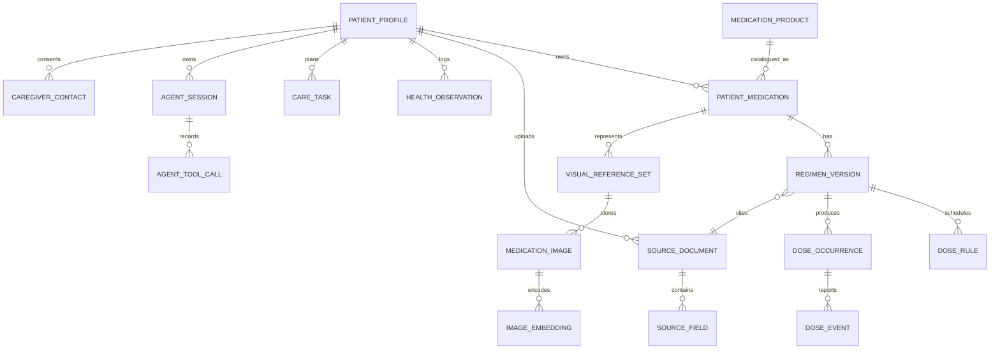

# PostgreSQL Data Model — source, medication, regimen, visual evidence, adherence and Agent state

**System of record:** Supabase PostgreSQL + `pgvector` (for 256-d verified encoder embeddings only), Supabase Auth, private object storage. **Do not put relational/PHI records into Hugging Face model Space**. These are target schemas, **not migrations already run**. See `AGENTS.md` for mandatory RLS, trace and testing rules.

## A. ER design and key ownership

Do **not** combine `MedicationProduct`, `PatientMedication`, `RegimenVersion`, `VisualReferenceSet` and `DoseEvent` into a single wide table. A product is a concrete market/strength/form identity; patient medication is a user's longitudinal association; regimen is a *time-bounded instruction version*; visual reference is evidence of appearance; dose event is **patient self-report** independent from recognition.

## B. Core tables and fields (types are PostgreSQL suggestions)

| Table | Primary key and columns | Relationships, indexes and constraints |
|---|---|---|
| `patient_profiles` | `user_id uuid PK` (references `auth.users.id`), `display_name text?`, `timezone text NOT NULL DEFAULT 'Asia/Singapore'`, `language text DEFAULT 'en'`, `visual_check_mode enum(SMART,ALWAYS_SUGGEST,REMINDERS_ONLY)`, `voice_default bool`, `is_demo bool`, `created_at timestamptz` | Unique user; one row/account; no NRIC; auth.uid isolation |
| `caregiver_contacts` | `id uuid PK`, `patient_id uuid FK`, `contact_type enum(email,phone)`, `contact_value text`, `relationship text?`, `verification_status enum(pending,verified,revoked)`, `consent_scope jsonb`, `consented_at timestamptz?`, `verified_at timestamptz?` | indexes(patient_id,verification_status); notifications cannot send until verified+consented |
| `source_documents` | `id uuid PK`, `patient_id uuid FK`, `source_kind enum(pharmacy_label,prescription,package,user_manual,mock_import)`, `storage_path text?`, `issued_at timestamptz?`, `uploaded_at timestamptz`, `is_synthetic bool`, `checksum text?` | private bucket; retention; idempotent duplicate uploads per patient/checksum as appropriate |
| `source_fields` | `id uuid PK`, `source_id uuid FK`, `field_name text`, `field_value jsonb`, `evidence_span text?`, `extraction_method text`, `confidence_raw numeric?`, `review_status enum(extracted,user_reviewed,professional_verified,rejected)` | index(source_id,field_name); extracted OCR not confirmed instructions |
| `medication_products` | `id uuid PK`, `generic_name text`, `brand_name text?`, `strength_value numeric?`, `strength_unit text?`, `dosage_form text`, `release_type text?`, `manufacturer text?`, `market_code text`, `local_registration_code text?`, `external_catalogue_id text?`, `created_at` | index(norm_name,strength,form,market), unique null-safe market/registration when available; do **not** globally unique generic drug name |
| `product_ingredients` | `id uuid PK`, `product_id uuid FK`, `ingredient_name text`, `normalised_identifier text?`, `amount numeric?`, `unit text?`, `mapping_source text?` | many-to-one; indexes(product_id), (normalised_identifier); DDI coverage status separately |
| `patient_medications` | `id uuid PK`, `patient_id uuid FK`, `product_id uuid? FK`, `display_name text NOT NULL`, `source_id uuid? FK`, `identity_status enum(unverified,user_reviewed_document,professional_verified)`, `created_at timestamptz`, `archived_at timestamptz?` | index(patient_id,created_at); cannot conclude specific product from image alone |
| `regimen_versions` | `id uuid PK`, `patient_medication_id uuid FK`, `source_id uuid? FK`, `version_no int`, `state enum(draft,active,ended,superseded,pending_clarification)`, `dose_amount numeric?`, `dose_unit text?`, `frequency_rule jsonb?`, `route text?`, `is_prn bool`, `food_instruction text?`, `source_reviewed_at timestamptz?`, `effective_from timestamptz?`, `effective_to timestamptz?`, `supersedes_id uuid? FK`, `created_at` | unique(patient_medication_id,version_no); partial unique ACTIVE regimen per medication **if clinically appropriate**; end >= start; active requires reviewed source & required schedule fields; retain all superseded versions |
| `dose_rules` | `id uuid PK`, `regimen_id uuid FK`, `local_time time?`, `days_of_week smallint[]?`, `rule_kind enum(scheduled,prn)`, `timezone text`, `enabled bool` | compare schedule in patient timezone; no occurrence inferred for PRN unless documented |
| `dose_occurrences` | `id uuid PK`, `patient_id uuid FK`, `regimen_id uuid FK`, `due_at timestamptz`, `status enum(scheduled,past_due,closed)`, `rule_id uuid?`, `generation_key text` | unique(patient_id,generation_key); indexes(patient_id,due_at); time window ≠ intake outcome |
| `dose_events` | `id uuid PK`, `patient_id uuid FK`, `occurrence_id uuid? FK`, `regimen_id uuid? FK`, `event_time timestamptz`, `intake_status enum(reported_taken,reported_not_taken,unsure,not_reported)`, `visual_status enum(not_checked,visually_consistent,ambiguous,unmatched,image_unusable)`, `recognition_run_id uuid? FK`, `evidence_method enum(self_report,photo_assisted,caregiver_report)`, `idempotency_key text`, `created_at` | unique(patient_id,idempotency_key); index(patient_id,event_time); do not equate confirmation with ingestion; status transitions validated in service |
| `visual_reference_sets` | `id uuid PK`, `patient_medication_id uuid FK`, `product_id uuid?`, `reference_type enum(personal_loose_pill,patient_package,catalogue_seeded_candidate,printed_blister,unprinted_blister)`, `verification_status enum(unverified,user_source_linked,professional_verified)`, `model_space text?`, `created_at`, `ended_at?` | references for history never automatically deleted; only `personal_loose_pill` eligible for existing `/match` unless a model is explicitly validated for other inputs |
| `medication_images` | `id uuid PK`, `reference_set_id uuid? FK`, `patient_id uuid FK`, `image_type enum(loose_front,loose_back,box,pharmacy_label,printed_blister,unprinted_blister,dose_check)`, `storage_path text`, `source_id uuid?`, `sha256 text`, `retain_until timestamptz?`, `consent_scope text?`, `created_at` | private object storage; index(patient_id,reference_set_id); daily dose check images short-lived by default, only recognition metadata persisted |
| `image_embeddings` | `id uuid PK`, `image_id uuid FK`, `embedding vector(256)`, `embedding_space_id text NOT NULL`, `encoder_name text`, `encoder_version text`, `preprocess_version text`, `normalised bool?`, `generated_at` | check all vector values finite in application; no compare across spaces; index(embedding_space_id,image_id); avoid ANN for tiny patient gallery |
| `recognition_runs` | `id uuid PK`, `patient_id uuid FK`, `image_id uuid?`, `task_kind enum(dose_check,unknown_pill,enrollment_reference)`, `image_quality_status text`, `decision text`, `catalogue_candidates jsonb?`, `model_version text?`, `embedding_space_id text?`, `threshold_version text?`, `tool_trace_id uuid?`, `completed_at timestamptz`, `status enum(success,partial,failed)`, `failure_reason text?` | index(patient_id,completed_at); no 'verified identity' derived from similarity; raw response scrubbing |
| `patient_conditions` (P2 optional) | `id uuid PK`, `patient_id uuid FK`, `condition_name text`, `code text?`, `source_id uuid?`, `reported_at timestamptz`, `verification_status text` | optional; diagnosis never inferred from prescribed drug or Gallery similarity |
| `health_observations` | `id uuid PK`, `patient_id uuid FK`, `observation_kind text`, `numeric_value numeric?`, `unit text?`, `text_value text?`, `observed_at timestamptz`, `source enum(patient_report,device_demo,documented)`, `created_at` | index(patient_id,observation_kind,observed_at); units consistent, no diagnosis inferred |
| `care_tasks` | `id uuid PK`, `patient_id uuid FK`, `kind enum(screening,vaccination,followup,medication_review,lifestyle,refill)`, `title text`, `source_id uuid?`, `due_at timestamptz?`, `state enum(pending,done,cancelled)`, `origin enum(user_provided,reviewed_source,demo_seed)`, `created_at` | no AI-created clinical screening indication without source/user request |
| `agent_sessions` | `id uuid PK`, `patient_id uuid FK`, `intent text?`, `state text`, `pending_slots jsonb`, `confirmation_token_hash text?`, `prompt_version text`, `state_version int`, `updated_at timestamptz`, `expires_at timestamptz?` | index(patient_id,updated_at); optimistic concurrency; never store unsanitized complete patient records in prompts |
| `agent_tool_calls` | `id uuid PK`, `session_id uuid FK`, `patient_id uuid FK`, `tool_name text`, `tool_status enum(started,success,failed,blocked,simulated)`, `request_summary jsonb`, `response_summary jsonb`, `policy_rule_id text?`, `provider_request_id text?`, `duration_ms int?`, `called_at timestamptz` | trace audits without secrets/PII; index(session_id,called_at) |
| `notifications` | `id uuid PK`, `patient_id uuid FK`, `caregiver_id uuid? FK`, `kind text`, `delivery_status enum(pending,delivered,failed,simulated,blocked)`, `due_at timestamptz?`, `sent_at timestamptz?`, `consent_snapshot jsonb?` | never falsely indicate `delivered` on mere queue insertion |
| `audit_events` | `id uuid PK`, `patient_id uuid FK`, `actor_type text`, `entity_type text`, `entity_id uuid`, `action text`, `before_redacted jsonb?`, `after_redacted jsonb?`, `occurred_at timestamptz` | tamper-evident intent, clear retention, no secrets or raw images |

## C. Important relational constraints and performance

- **Foreign keys and ownership consistency** across patient-owned joins: a dose event cannot point to another patient's regimen or recognition run. Enforce via service checks or composite foreign keys, not only RLS UI filtering.
- **Patient isolation**: `auth.uid() = patient_id` for every owned table, or join policy through parent ownership. Private storage bucket signed URLs and appropriate storage policy. Backend `service_role` bypasses RLS: never send it to browser, and do not rely solely on RLS if server uses elevated key; validate patient scoping in service.
- **Index** `(patient_id, effective_from/effective_to)` via join/snapshot for active regimens, `(patient_id, due_at)` for dose occurrences, `(patient_id,event_time)` for dose events, `(patient_id,observed_at)` observations, `(session_id,called_at)` tool logs, `(reference_set_id, image_type)` images.
- **Vectors**: `vector(256)` is valid only after exact embedding width verified. If model upgrade changes dimensions, add dimensioned table/version or migrate intentionally; don't coerce unrelated embedding spaces. Small Gallery requires exact cosine, not premature approximate vector search. Even if L2-normalized, semantic confidence must be empirically calibrated.
- **Regimen state**: require source-reviewed quantity/frequency/etc to mark `active`; historical rows immutable except explicit audited corrections. Use transaction for `supersede(old) + activate(new) + reschedule future dose occurrences`. Previous events remain attached to old version.
- **Time**: UTC timestamptz database, patient IANA timezone for planned local doses; `created_at` ≠ occurrence time; never infer ingestion from reminders.
- **Demo seeding**: create synthetic products and 7-day patient records with deterministic seed, idempotent per demo user; use fresh anonymous `auth.uid()` per evaluator, explicit Reset Demo. Protect anonymous creation from spam and schedule cleanup.
- **Images**: original uploaded photo optionally retained for enrollment references; dose-check original short retention or inference-only with results retained. Preserve ability to recompute embeddings if consent/source allows after model change. Never use `.hf.space` as patient gallery database.

## D. Minimal P0 migration order

1. `patient_profiles`, `medication_products`, `patient_medications`, `source_documents`, `source_fields`.
2. `regimen_versions`, `dose_rules`, `dose_occurrences`, `dose_events`, indexes and RLS; synth seed.
3. `visual_reference_sets`, `medication_images`, `image_embeddings`, `recognition_runs` + version checks.
4. `agent_sessions`, `agent_tool_calls`, `audit_events`.
5. P1: `health_observations`, `care_tasks`, `caregiver_contacts`, `notifications`.

**Test migrations in temporary/local PostgreSQL before Supabase production**. Keep down/migration rollback strategy, never destructive changes without backup/approval.

**Optional conditions:** if the later personalisation roadmap needs known diagnoses, add `patient_conditions` with patient-reported or documented provenance; not required for pill Gallery or regimen check, and should never be populated by predicting diagnoses from medication names.
