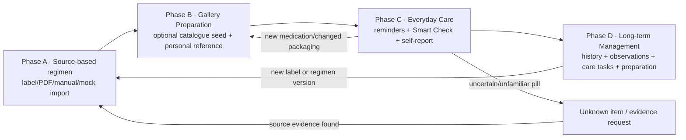
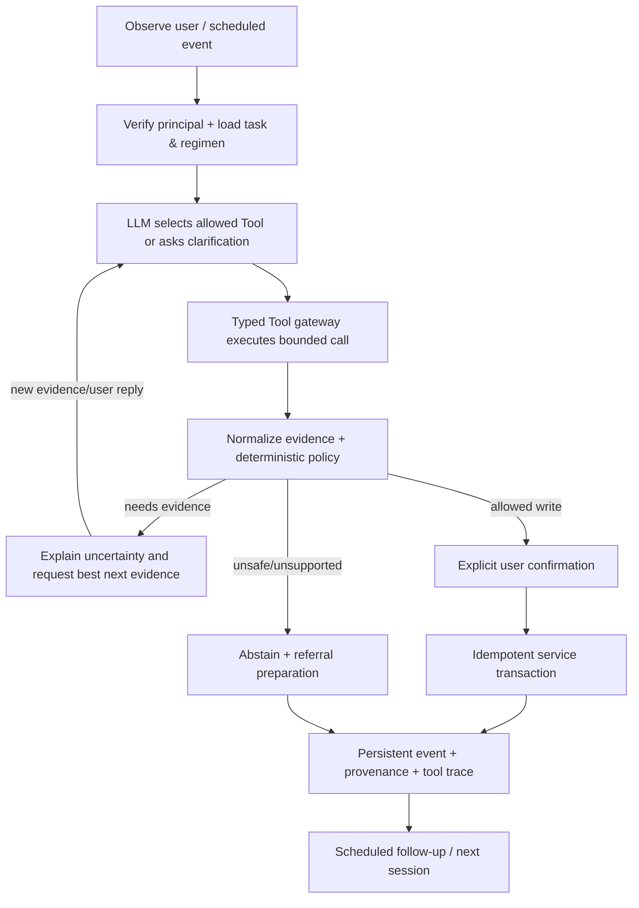
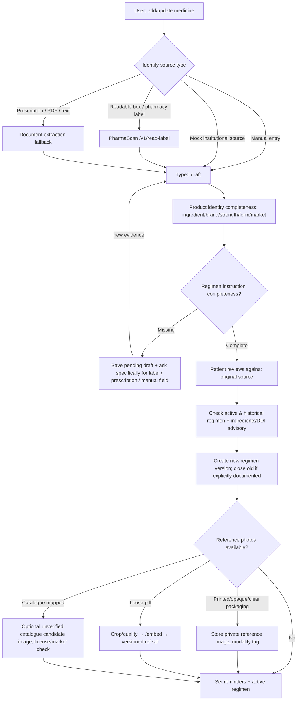

# PharmaScan Care — Detailed Business, Agent, Activity and Tool Flows

> Intent states and backend effects are **design contracts**. No claims of existing implementation. Preserve prior design snapshots in `docs/reference/` as the Stage2 owner is already following them.

## I. The overall medicine lifecycle (Claude's A–D + our agentic extension)



**Business rules:** all phases reachable directly by voice/chat; no requirement to start from a doctor portal; no photo required for adherence recording; full Stage1→Stage4 visual chain only appears within some Phase C branches. Phase D includes changed prescriptions, stopped treatments, longitudinal data and prevention, not just deletion from active gallery.

## II. Agent Loop with concrete state changes

**States:** `idle`, `clarifying_intent`, `collecting_evidence`, `awaiting_user_review`, `awaiting_sensitive_confirmation`, `executing_tool`, `awaiting_retry`, `unresolved`, `completed`, `cancelled`, `escalation_preparation`.

**Example:** patient says "I don't remember whether I took my morning pill and this blister has no writing." The Agent MUST (1) identify two distinct questions (intake status and unprinted blister identification); (2) read today's dose event and active regimen with authorization; (3) return `not_reported` or `unsure` rather than `missed` if evidence absent; (4) route image as packaging and avoid `/embed` if intact/unprinted; (5) ask for original pharmacy label/box or professional clarification; (6) save `unresolved` with `next_action`, no redose advice; (7) later resume task from `agent_sessions`.



### Plan and prompt boundaries

- **System prompt**: define Agent role, available tools, risk boundaries, patient-friendly explanation, uncertainty, no autonomous medical advice; fixed version and tests.
- **Task context**: patient-specific, authenticated, minimum necessary structured records (regimen IDs, status, dates, not unnecessary complete clinical history).
- **Tool descriptions**: intent, schema, side effects, required confirmations, safe fallback and contract/versions.
- **Retrieved information**: OCR text, medicine labels and catalogue candidates tagged `UNTRUSTED_EVIDENCE`, never command authority. No chain-of-thought logging; record tool calls and decisions.
- **Policy**: deterministic allowed actions/blocked reasons; LLM may compose explanations only within returned evidence and source citations.

## III. Enrollment and versioned gallery flow (Activity + API)



### Inputs at enrollment

- **To create a medication draft:** user identifies source (`pharmacy_label`, `prescription`, `package`, `manual`, `synthetic_mock`), supplies source photo/text or manual product details. Persist only what user supplied/extracted with provenance.
- **To activate a specific scheduled regimen:** reviewed *written or explicitly entered source* for drug name + relevant strength + dosage form + dose amount/unit + frequency/timing or PRN + route where applicable, source review status. Unknown `start_date`/`end_date` nullable; avoid inventing duration. OTC/supplements may have `source_kind=package_user_defined`; need warnings and do not label it prescription verified. Patient confirmation cannot substitute for pharmacist verification.
- **Optional:** ingredient/brand/manufacturer/registration number, date, expiry, quantity, clinician, diagnosis, delivery, allergies, conditions, package photo, 3–5 front/back loose-pill photos, caregiver, reminder preferences. Do not infer diagnosis from drug name; no NRIC.
- **Agent-generated:** extraction suggestions; product duplicates; ingredient mapping coverage; draft; source conflicts; reminders; proposed summary; reference embeddings only if an appropriate picture and encoder contract exist. Do not invent dose or start a new treatment autonomously.

### Source semantics

`package`
- primarily supports product identity:
  name, strength, dosage form, ingredient, manufacturer/market identifiers
  when visible;
- does NOT automatically establish this patient's prescribed schedule.

`pharmacy_label` / `prescription`
- may additionally supply patient-specific regimen fields:
  dose amount, frequency, timing, PRN, route, duration and special instructions;
- only fields explicitly present in the source may be stored as extracted facts.

A medication product may be recorded while its regimen remains
`pending_clarification`.

### Reference sets / catalogue-first proposal

```
MedicationProduct (specific market+form+strength)
  ├─ CatalogueSeededCandidate [US C3PI reference, mapped & not verified]
  ├─ PatientPackagingReferences [box/label/blister; private image only]
  └─ PatientLoosePillReferenceSet [personal photos + 256-d embeddings]

PatientMedication → Product → RegimenVersion[ACTIVE/HISTORICAL]
```

The catalogue prefill option **reduces enrolment friction only if** its product mapping is exact enough, image use permitted and visual tests support it. Existing `/v1/pills/{id}/embeddings` was *proposed* in Claude's example, not confirmed deployed; fallback is no seeded candidate. Avoid treating a catalogue image automatically as a patient's verified pill.

## IV. Daily dose, photo optional (activity, evidence and actions)

```mermaid
flowchart TD
  T[Reminder or user intent] --> Reg[Get current regimen + prior dose event]
  Reg --> Choice{Smart Check / Always Check / Reminders Only; patient choice?}
  Choice -->|No photo / skipped photo| Report[Self-reported taken / not yet / unsure]
  Choice -->|Check pill| Mod{Input modality}
  Mod -->|Loose pill| Quality[Quality + crop; guard duplicate boxes]
  Mod -->|Readable package / pharmacy label| Text[/v1/read-label → normalized product/source fields → compare against recorded product + active regimen]
  Mod -->|Unprinted blister| NoInfo[No reliable identity → request original label]
  Quality -->|usable| Embed[/v1/embed + /v1/match personal ref]
  Quality -->|unusable| Retake[Guided retake based on measured quality flags]
  Embed -->|ambiguous/unmatched| Catalogue[/v1/identify candidate lookup, optional front/back/imprint]
  Embed -->|visually consistent| Gate[Policy: current regimen, conflicts, event history]
  Catalogue --> Gate
  Text --> Gate
  NoInfo --> Retake
  Gate -->|unreliable| Retake
  Gate -->|reportable limited evidence| Explanation[Concise explanation: visually consistent ≠ safe to take]
  Retake --> Explanation
  Explanation --> Report
  Report --> Save[record_dose_event: visual_status & intake_status separate]
  Save --> Next[Next reminder / unresolved follow-up]
```

**Readable package / pharmacy label is identity-first:** a package or pharmacy label read through `/v1/read-label` is compared against the recorded product and the active regimen. General package information (brand, strength, form, manufacturer) must **not** be used to modify the patient's regimen; only fields explicitly present in the source and reviewed by the patient may create or change a regimen version.

**Smart Check default:** suggest photo when new drug, changed ref, visual uncertainty, manufacturer/appearance change or user asks. Not mandatory per dose; default UI [Taken] [Check pill] [Not now] [Unsure]. Settings offer `SMART`, `ALWAYS_SUGGEST` and `REMINDERS_ONLY` without coercive checks. A photo cannot prove ingestion. When user already took a dose, log it as self-report without pretending it was visually checked.

**Why a match failure?** Let tooling return explicit observable flags `blur/glare/too_small/crop_cutoff/multiple_overlapping_boxes/imprint_unreadable` *only when actually computed*. Return `good_quality_but_unmatched` and `ambiguous_candidates` if verified using trained thresholds. LLM may explain signals, but **never invent a photographic reason**. If no reliable model quality flags, generic uncertainty + options.

**Count:** automatically counting pills in a scene cannot be trusted until `/scan` one-pill double-box regression and multi-pill localization are fixed. Until then demo single cropped pill only; daily reminders and histories are still usable. `dose_quantity=2` does not mean a single detected pill proves 2 have been taken.

## V. Unknown pill / package / unlabeled blister

- `IDENTIFY_UNKNOWN` user intent bypasses personal medication dose checking. Stage2 `/identify` returns **possible US catalogue visual candidates**, not confirmed identity; imprint if user supplies it, and candidate metadata are source-tagged.
- Printed package/label → `/v1/read-label` first → present the extracted product candidate → the patient may separately choose to create a **pending enrollment** after source review.
- Transparent blister no readable text → can retain personal packaging photo if provenance exists, but **loose-pill encoder cannot be presumed valid through plastic reflections**; ask for original box/label/pharmacist without opening sealed packaging just for the app.
- Opaque foil and no text → `unverified`, no image-based identification. Unknown drug cannot silently start regimen or become new model class/training sample.

## VI. Long-term health journey and regimen changes

`reminder_due`/`followup_due`/`user_health_checkin` → get regimen history, counts by reliable status (exclude `unreported` from confirmed failure), maybe ask barrier: forgetful, unavailable medicine, unclear directions, adverse sensations, inconvenience → log own report and optionally health measurement (BP, glucose, symptoms, sleep) → date/unit-aware trend, not causal diagnosis → existing personalized preventive task (screening/vaccination/lifestyle/follow-up) from user/verified guidance → patient-reviewable review summary and pharmacist/doctor questions → next event. Regimen expired: end version, retain history/gallery, stop active scheduling; changed instruction creates new version and reevaluates DDI if mapped.

## VII. Four representative real tool traces for Demo/Agent tests

**Trace A / Enrollment:** `resolve_intent(ADD)` → `extract_document(label)` → `find_product` → `compare_current_regimens` → `request_missing(dose_frequency)` → patient reply → `confirm_source_fields` → `screen_ingredients(coverage)` → `create_versioned_regimen` → `schedule_reminder` → persist.

**Trace B / Normal image:** `get_active_regimen` → `get_current_dose_event` → `image_quality` → `embed_image` → `match_personal_gallery` → `evaluate_evidence` → `explain_limited_match` → user says Taken → `record_self_report` → persist.

**Trace C / Duplicate boxes:** `get_regimen` → `scan_diagnostics` gives two overlapping boxes → `validate_detection` marks count unreliable → no dose-count comparison → `ask_one_pill_crop` → image retry → `embed + match` or abstain → persist unresolved if no reliable evidence.

**Trace D / Late check-in:** `get_history` → `summarize_unconfirmed` → `ask_adherence_barrier` → `record_health_observation` → `get_preventive_tasks` → `prepare_review_summary` → user confirms content/export.

## VIII. Tool failure / control-flow rules

- Network timeout: present 'visual check unavailable', do not report success; choose no-photo self-report or manual reference verification, persist task as degraded.
- Source file with dose instruction missing: draft stays incomplete; no active timed plan.
- Product mismatch/old regimen: warn that photo cannot confirm current medication, direct user to written source/pharmacist; do not tell them to skip prescribed medication as unilateral clinical instruction.
- Discontinued medication recognized in reference set: report 'this resembles an item recorded in historical medications, but it is not listed as active'; do not activate it.
- Duplicate `Taken` click: idempotent event key prevents double event; ask for clarification if different source actions conflict.
- External label text prompt injection: never affect agent instructions/actions; treat as quoted source data only.
